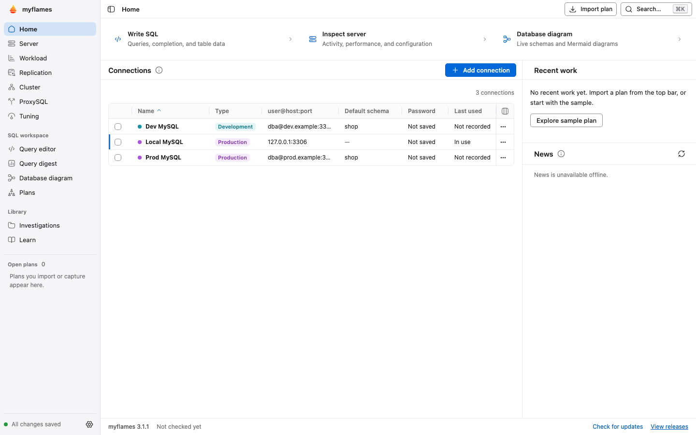
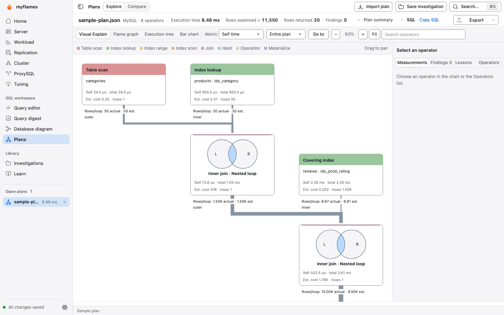
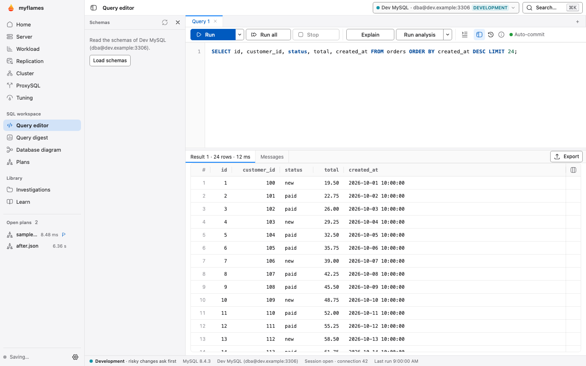
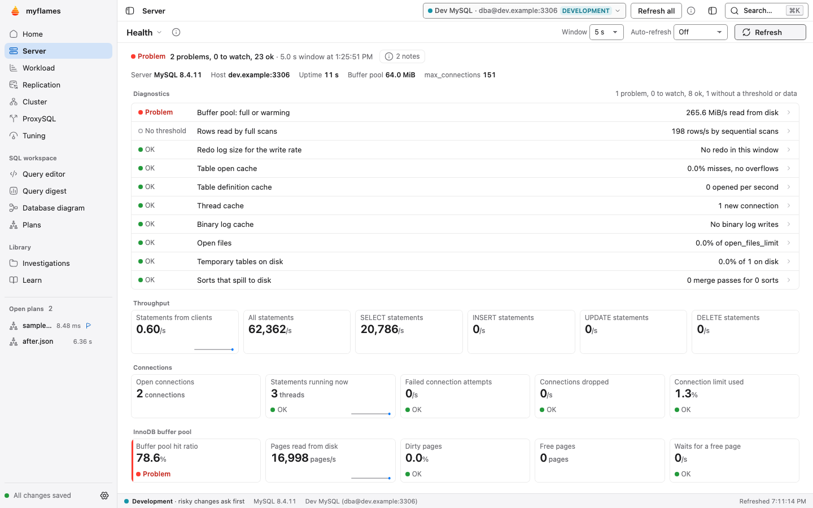

<p align="center">
  
</p>

# myflames

**myflames** is a macOS performance workspace for MySQL, MariaDB and Percona Server, plus a Python CLI with no third-party dependencies. It visualizes `EXPLAIN ANALYZE FORMAT=JSON` plans as Visual Explain diagrams, flame graphs, execution trees and bar charts, compares before and after plans, runs SQL in a multi-tab Query editor, inspects schemas and server health, and checks queries in CI or through an MCP server.

Inspired by [Brendan Gregg's FlameGraph](https://github.com/brendangregg/FlameGraph) and [Tanel Poder's SQL Plan FlameGraphs](https://tanelpoder.com/posts/visualizing-sql-plan-execution-time-with-flamegraphs/).

## Screenshots









Try a [MySQL plan demo](https://vgrippa.github.io/myflames/demos/live-mysql/live-mysql-derived-table-flamegraph.html) or a [MariaDB plan demo](https://vgrippa.github.io/myflames/demos/live-mariadb/live-mariadb-derived-table-flamegraph.html) in your browser.

## Highlights

- **Plans and plan comparison**: Inspect `EXPLAIN ANALYZE FORMAT=JSON` and `EXPLAIN FORMAT=JSON` plans as Visual Explain diagrams, flame graphs, execution trees or bar charts, with ranked findings, operator search and interactive algorithm lessons in Learn. Save captures into Investigations and compare before and after plans side by side in Compare.
- **Query editor, Query digest and Database diagram**: Run SQL across multiple tabs with dedicated sessions, schema and column completion, SQL formatting, parameter binding, editable InnoDB table data and CSV, JSON, SQL or Markdown export. Summarize statement digests in Query digest and inspect or export entity-relationship diagrams in Database diagram.
- **Server views and Tuning**: Check live metrics in Health, InnoDB, Error log, Waits, I/O, Indexes, Tables, Parameters (linked to official MySQL, MariaDB and Percona manuals) and Instruments, or refresh all views at once. Open Tuning for configuration checks and the Full analysis report.
- **Processlist and Locks**: Inspect active connections, open transactions and running queries in Processlist, explain a live session's statement, or end runaway queries with single or bulk Kill. Trace blocking trees, waiting DDL, metadata locks, InnoDB row locks and the latest deadlock in Locks. Ages and waits use readable durations; exact seconds are on hover in duration tables, Processlist detail facts and Locks summary facts (see [the workspace guide](docs/LOCAL_UI.md)).
- **Replication, Cluster and ProxySQL**: Monitor replica channels, GTID positions, applier workers and lag in Replication, and skip one failed transaction or run a bounded skip loop after review. Inspect MariaDB Galera, Percona XtraDB Cluster, MySQL InnoDB Cluster and Group Replication topology and member actions in Cluster, or inspect backend pools, query rules and digests in ProxySQL and review changes to backend server settings and rule activation.
- **Users and roles**: List accounts and roles without exposing password hashes, inspect effective grants and privileges, and create, drop, rename, lock, expire passwords or change grants and roles after reviewing the exact SQL and before-and-after grant diff.
- **Maintenance**: Detect local client tools (`mysqlsh`, `mysqldump`, `mariadb-dump` and others), run pre-upgrade checks, and run preflighted dumps, restores and MySQL `CLONE` jobs with progress, cancellation and manifest verification.
- **Write safety and the audit log**: Every connection is Production (confirms every change), Development (confirms risky changes such as DDL, `KILL`, `SET GLOBAL`, replication skips and `CLONE`) or Read-only (refuses all changes before connecting). Every confirmed, refused or declined change is recorded in the local Audit log (`Settings > Audit log` or `myflames audit`) without passwords.
- **CLI, CI gates and MCP for agents**: Generate standalone SVG or HTML reports, compare plans, emit compact text digests (`myflames digest`), gate pull requests on plan rules or server checks (`--fail-on`), or expose read-only analysis and live inspection tools to AI agents with `myflames-mcp`.

## Install

### macOS app

1. Download `myflames-3.2.0-macos-arm64.dmg` from [GitHub Releases](https://github.com/vgrippa/myflames/releases) (Apple Silicon), open it, and drag `myflames.app` to `/Applications`.
2. Double-click `myflames.app`. It is signed with a Developer ID and notarized by Apple, so macOS opens it without extra steps. Releases before 3.2.0 were unsigned zips: Control-click those in Finder and choose **Open** the first time.

The packaged app keeps its data under `~/Library/Application Support/myflames-desktop`, unless overridden by `MYFLAMES_DESKTOP_DATA`. Its workspace database and audit records are in `backend-home/.myflames/workspace.sqlite3`; saved passwords use `credentials.vault` and `vault.key` in that same `.myflames` folder. Desktop and CLI data are separate; the CLI uses `~/.myflames`. You can check for newer releases on demand with **Check for updates** on Home or in **Settings > About myflames**.

Live server features use a local `mysql` or `mariadb` client and optional `mysqlsh`, `mysqldump` or `mariadb-dump` binaries. The app discovers them automatically on `PATH` and in standard Homebrew, MacPorts and vendor folders (`/opt/homebrew/bin`, `/usr/local/bin`, `/opt/local/bin`, `/usr/local/mysql/bin`).

While Home is open, the app fetches up to six headlines from Planet MySQL and the MariaDB Foundation over HTTPS and caches them for six hours. Turn this off in **Settings** with **Show MySQL and MariaDB news on Home**; nothing is fetched while it is off.

### Python CLI

The CLI requires Python 3.7 or later and uses the Python standard library only.

```bash
pipx install myflames
# or: pip install myflames
```

From a source checkout, run `python3 myflames.py` or `python3 -m myflames` directly.

## Engine compatibility

| Capability | MySQL 8.0 | MySQL 8.4 and 9.x | MariaDB 10.11+ and 11.x | Percona Server 8.0 and 8.4 / PXC |
| :--- | :--- | :--- | :--- | :--- |
| **Offline plan files** | `EXPLAIN FORMAT=JSON` (cost estimates; no operator timing) | `EXPLAIN ANALYZE FORMAT=JSON` and `EXPLAIN FORMAT=JSON` | `ANALYZE FORMAT=JSON` and `EXPLAIN FORMAT=JSON` | 8.0: `EXPLAIN FORMAT=JSON`; 8.4: `EXPLAIN ANALYZE FORMAT=JSON` |
| **Live plan capture (`capture`, `-e`, Explain)** | `EXPLAIN FORMAT=JSON` with `capture --mode explain`; root `-e` needs 8.4+ for JSON analysis | Estimated and timed plans, schema, statistics, variables and trace | Estimated and timed plans, schema, statistics, variables and trace | 8.0: `EXPLAIN FORMAT=JSON`; 8.4: `EXPLAIN ANALYZE FORMAT=JSON` |
| **Query editor, Query digest, Database diagram** | SQL sessions, digest summaries and schema diagrams | SQL sessions, digest summaries and schema diagrams | SQL sessions, digest summaries and schema diagrams | SQL sessions, digest summaries and schema diagrams |
| **Server views, Processlist, Locks, Tuning** | Server diagnostics; `performance_schema.error_log` requires 8.0.22+; older 8.0 gets file-viewing guidance | Server diagnostics | `userstat` fallbacks for index usage and table I/O when enabled; Waits requires Performance Schema. `metadata_lock_info` for MDL; verified local error log file or guidance | Server diagnostics plus Percona `userstat` index and table stats, thread-pool metrics, `log_slow_rate_limit` checks and Percona parameter links |
| **Replication and Cluster** | Replication (`SHOW REPLICA STATUS` / `SHOW SLAVE STATUS`), InnoDB Cluster, Group Replication | Replication (`SHOW REPLICA STATUS`), InnoDB Cluster, Group Replication | Replication (`SHOW ALL SLAVES STATUS`, `gtid_slave_pos`), MariaDB Galera Cluster | MySQL Replication, Group Replication, Percona XtraDB Cluster (`wsrep_*`, `pxc_cluster_view`) |
| **Users and roles** | Users, roles, default roles, partial revokes and dynamic privileges | Users, roles, default roles, partial revokes and dynamic privileges | Users, MariaDB roles, `SET DEFAULT ROLE` and `PUBLIC` | MySQL privilege and role model |
| **Maintenance** | Upgrade check (`mysqlsh` or partial native subset), dump, restore, `CLONE` (8.0.17+) | Upgrade check, dump, restore, `CLONE` | Dump and restore (`mariadb-dump`); points to `mariadb-upgrade` and `mariadb-backup` for upgrades and physical copies | Upgrade check, dump, restore, `CLONE` (Percona Server) |

For manual MySQL JSON generation on 8.3+, select format version 2 with `SET SESSION explain_json_format_version=2` before EXPLAIN. This implementation requires MySQL 8.4+ for timed JSON analysis.

ProxySQL 2.x and 3.x are supported in the ProxySQL place when connected to a ProxySQL Admin interface.

## CLI examples

Live examples assume saved `prod` and `dev` profiles and an `orders` table. `before.json` and `after.json` are captures from before and after a change; `explain.json` below can be either capture or an exported plan.

Capture a live plan with schema, table statistics and session variables, then render a self-contained HTML report:

```bash
myflames capture -p --profile prod -e "SELECT * FROM orders WHERE customer_id = 42" -o before.json
myflames --type workbench before.json -o plan.html
```

Compare two plans in an HTML diff or a compact text diff:

```bash
myflames compare before.json after.json -o diff.html
myflames compare before.json after.json --digest
```

Run a full server analysis report or list the heaviest statements from Performance Schema:

```bash
myflames report -p --profile prod --html -o server-report.html
myflames top -p --profile prod --order total --limit 25
```

Run SQL from the command line under the connection's write-safety policy:

```bash
myflames sql -p --profile dev -e "SELECT id, status, total FROM orders ORDER BY id DESC LIMIT 10"
```

Gate a CI pipeline on plan findings or server health checks (exits `1` when triggered):

```bash
myflames check after.json --fail-on full_scan,filesort,temp_table
myflames health -p --profile prod --fail-on problem
```

Start the read-only stdio MCP server for Claude Code, Cursor or another MCP host:

```bash
pip install 'myflames[mcp]'
myflames-mcp
```

```json
{
  "mcpServers": {
    "myflames": {
      "command": "myflames-mcp"
    }
  }
}
```

## CLI reference

### Commands

Invoke subcommands with `myflames <command>` or `python3 -m myflames <command>`. The root command renders a plan file or stdin; its flags are listed below.

| Command | Primary options | Purpose |
| --- | --- | --- |
| `ui` | `[--port PORT] [--no-browser] [--no-restore]` | Deprecated: launch the browser performance workspace (use the macOS app, `myflames.app`). |
| `sql` | `[-e SQL \| -f FILE] [--format {table,tsv,csv,json,markdown,insert}] [--insert-table NAME] [--limit N] [-o PATH] [--yes]` | Run SQL in one editor session with safety policies. Results carry no column types: JSON keeps numbers as strings, table quotes them and INSERT writes them as quoted text. NULL and empty strings stay distinct: JSON uses `null` and `""`; CSV uses an unquoted empty field and `""`; table uses `NULL` and `""`; Markdown uses `*NULL*` and an empty cell. Interactive sessions are not supported. |
| `capture` | `[-e SQL \| --statement-digest HASH] [--mode {explain,analyze}] [--trace] [-o PATH]` | Capture estimated plans by default, with schema, table statistics and session variables. `--mode analyze` executes a SELECT in a rolled-back read-only transaction; `--trace` adds optimizer trace. `--digest HASH` is a deprecated alias of `--statement-digest HASH`. |
| `explore` | `PLAN [--type TYPE] [--metric METRIC] [--focus ID] [-o PATH]` | Export an interactive plan visualization HTML file. |
| `compare` | `before.json after.json [--digest \| --json] [-o PATH]` | Compare two execution plans and report operator differences. |
| `diff` | `before.json after.json [--digest \| --json] [-o PATH]` | Deprecated alias of `compare`. |
| `top` | `[--order {total,time,avg,examined,rows,count,exec_count,full_join,scan,scans,no_index,tmp_tables,locks}] [--table SCHEMA.TABLE] [--schema NAME] [--limit N] [--json] [-o PATH] [-q]` | Rank expensive statements from Performance Schema digests. |
| `sessions` | `[--all] [--min-seconds N] [--session-user USER] [--schema NAME] [--kill ID [--query] [--yes]] [--explain ID]` | The CLI for the **Processlist** view: inspect connections, running queries, idle transactions and thread states. Kill protects Group Replication streams even when their command name is truncated. |
| `running` | `[--min-seconds N] [--explain ID] [--json] [-o PATH]` | Deprecated alias of `sessions`, retaining the `running-1.0` contract. |
| `locks` | `[--waits-only \| --deadlock \| --kill ID [--query] [--yes]]` | Trace lock waits, metadata blockers and deadlocks. `--kill ID` ends the connection; `--query` stops only its query. Kill shares the Group Replication stream guard with Sessions and reports when completion could not be verified. |
| `health` | `[--interval N] [--fail-on {problem,watch}]` | Sample server status counters over time to detect health anomalies. |
| `innodb` | `[--raw] [--fail-on {problem,watch}]` | Parse and summarize SHOW ENGINE INNODB STATUS output. |
| `error-log` | `[--level LEVEL[,LEVEL...]] [--limit N] [--fail-on {problem,watch}]` | Read the server error log: `performance_schema.error_log` on MySQL; on MariaDB the log file, only when the server runs on this computer. |
| `waits` | `[--interval N] [--limit N]` | Rank wait events over a sampling window and since server boot. |
| `indexes` | `[--schema NAME] [--all-schemas] [--limit N]` | Find unused and redundant indexes and tables read mostly by full scans; partitioned or unknown candidates stay under No data. |
| `tables` | `[--schema NAME] [--all-schemas] [--fresh]` | Find tables without a primary key or usable unique key, and report InnoDB reusable free space. Reusable allocation is informational and does not trigger a warning exit code on its own. |
| `io` | `[--interval N] [--schema NAME] [--all-instances]` | Analyze file and table I/O throughput. |
| `config` | `[--fail-on LEVEL]`; `set NAME VALUE [--persist \| --persist-only \| --session] [--yes]`; `reset-persist NAME [--yes]` | Review server settings or change one variable after exact SQL review. No modifier on `set` means global. |
| `instruments`| `[--preset {minimal,locks,waits,defaults}]` | Review Performance Schema instrumentation and generate setup SQL. |
| `report` | `[--interval N] [--schema NAME] [--all-schemas] [--html \| --json \| --markdown] [-o PATH]` | Compose the Full analysis report from health, waits, I/O, configuration, InnoDB, sessions, instruments, server checks, tables and indexes. Error log and Locks are outside its coverage. |
| `replication` | `[--channel NAME]`; `skip --channel NAME [--yes]`; `skip-loop --channel NAME --errors CODES [--max N] [--max-minutes M] [--yes]` | Monitor replica lag and source versions, skip one failed transaction, or run a bounded recovery loop. Both recovery commands require `--channel`; use an empty string for the default channel. |
| `cluster` | `[--fail-on {problem,watch}] [--json] [-o PATH] [-q]` | Show the Galera, Percona XtraDB Cluster, InnoDB Cluster or Group Replication cluster the server belongs to (`cluster-1.0`); read-only. |
| `accounts` | `list`, `show`, `create`, `drop`, `rename`, `lock`, `unlock`, `expire`, `password`, `grant`, `revoke`, `role grant`, `role revoke`, `role default` | Inspect and manage users, roles, passwords and privileges. Writes require review and support `--yes` and `--json`. |
| `privileges` | `[--json]` | Report effective permissions and per-action verification status. |
| `upgrade-check`| `--target-version X.Y.Z [--no-shell]` | Run MySQL Shell upgrade checks or native compatibility checks. |
| `dump` | `DIRECTORY [--schema NAME] [--table NAME] [--threads N] [--yes] [--preflight]` | Dump an instance, schemas or tables to a new or empty directory with preflight checks and checksum manifests. Repeat `--schema` or `--table` for several names. |
| `restore` | `DIRECTORY [--confirm-target TARGET] [--yes] [--preflight]` | Restore a validated dump and verify objects and recorded row counts. Confirmation must match the complete target printed by the plan, including a schema or directory when present. |
| `clone` | `--donor-profile NAME [--confirm-target TARGET] [--yes] [--preflight]` | Clone a MySQL donor to the connected recipient. Alternatively select the donor with `--donor-host HOST --donor-port PORT --donor-user USER --donor-password` (prompts for its password). Confirm the complete target printed by the plan. |
| `profiles` | `list`, `set NAME [--type TYPE] [--read-only \| --read-write]`, `forget NAME`, `delete NAME` | Manage saved connections and safety settings; `forget` removes a saved password. |
| `audit` | `list [--since DAYS] [--server NAME] [--limit N]`, `export [--json \| --csv]`, `purge [--older-than DAYS]` | Query, export and maintain the local server write audit trail. |
| `check` | `PLAN [--fail-on LIST] [--ignore LIST]`; `--list-rules` | Gate plans on categories such as `full_scan`, `filesort`, `temp_table` and `misestimate`, severities, or `any`. Use `--list-rules` for the complete catalog. |
| `advise` | `PLAN [--ignore LIST] [--json]` | Provide ranked optimization suggestions for an execution plan. |
| `findings` | `PLAN [--ignore LIST] [--json] [-o PATH]` | Deprecated alias of `advise`. |
| `digest` | `PLAN [--cost] [--tokenizer {heuristic,claude,gpt}] [--json]` | Emit a compact text digest. `--cost` compares token costs; `--json` emits that cost comparison, not the digest text. |
| `tokens` | `PLAN [--cost] [--json] [--show-prompts] [-o PATH]` | Deprecated alias of `digest`, defaulting to `--cost`. |
| `import-shell` | `BUNDLE [--query N] [--list] [-o PATH] [-q]` | Convert a diagnostics ZIP produced by MySQL Shell `util.debug.collectSlowQueryDiagnostics()` into capture JSON. |
| `guide` | `[-o PATH] [-q]` | Show which visualization to choose for a use case. |
| `teach` | `[LESSON] [--index \| --catalog] [--title TITLE] [-o PATH] [-q]` | Render a lesson such as `btree`, `bnl`, `hash`, `join` or `lru`, or use `--index` or `--catalog` for the catalog. Run `teach --help` for every lesson name. |

### Agent and CI subcommands

```bash
# Compact text digest and token cost comparison
myflames digest explain.json
myflames digest explain.json --cost --tokenizer claude

# Ranked findings as a JSON array
myflames advise explain.json --json

# Before/after plan comparison for pull requests or agents (compare-1.0)
myflames compare before.json after.json --digest
myflames compare before.json after.json --json

# CI gate: exit 0 when clean, 1 when a listed rule category fires, 2 on bad input
myflames check explain.json --fail-on full_scan,filesort,temp_table
myflames check --list-rules
```

Read and analysis gates generally use `0` for success, `1` for a triggered gate and `2` for bad input or connection failure. Write commands also distinguish unsent refusals from sent failures: started lifecycle jobs and variable changes can return `1` for failure, cancellation or an unverifiable result without `--fail-on`. See each command's help.

### Visualization options

| Flag | Default | Description |
| :--- | :--- | :--- |
| `--type` | `flamegraph` | Output chart type: `flamegraph`, `bargraph`, `diagram`, `tree`, `workbench` (`treemap` is a deprecated alias for `bargraph`). |
| `-o`, `--output PATH` | stdout | Write output to `PATH`. Use `.html` for a self-contained HTML report. |
| `--width PX` | `1800` / `1200` | SVG width in pixels (`1800` for flame graphs, `1200` for other views). |
| `--height PX` | `32` | Frame height in pixels for flame graphs. |
| `--colors SCHEME` | `hot` | Flame graph palette: `hot`, `mem`, `io`, `red`, `green`, `blue`. |
| `--title TEXT` | `MySQL Query Plan` | Custom chart title. |
| `--inverted` | off | Render an icicle graph (root at top). |
| `--no-enhance` | off | Disable detailed flame graph tooltips. |
| `--query SQL` | none | Embed SQL query text in the output report. |
| `--query-file PATH` | none | Embed SQL query text read from `PATH`. |
| `--sidecar PATH` | auto with `-o` | Write the schema version `1.4` JSON sidecar to `PATH`. Both `plan.html` and `plan.svg` produce `plan.json` by default. |
| `--no-sidecar` | off | Do not write the automatic JSON sidecar beside the output file. |
| `--no-teach-bundle` | off | Do not emit the `teach/` lesson folder beside `.html` output. |
| `--refresh-teach-bundle` | off | Regenerate the `teach/` folder beside `.html` output even if it exists. |
| `-q`, `--quiet` | off | Suppress informational stderr messages while preserving stdout and exit codes. |

### Connection options

| Flag | Description |
| :--- | :--- |
| `--profile NAME_OR_ID` | Use a saved connection profile (and its saved password) for `-e` and live subcommands (`sql`, `capture`, `top`, `sessions`, `locks`, `innodb`, `error-log`, `health`, `waits`, `indexes`, `tables`, `io`, `config`, `instruments`, `report`, `replication`, `cluster`, `upgrade-check`, `dump`, `restore`, `clone`, `privileges`, `accounts`). Explicit flags override profile fields. |
| `-h`, `--host HOST` | Server hostname or IP address (default `127.0.0.1`; host-and-port connections use TCP). |
| `-P`, `--port PORT` | Server TCP port (default `3306`). |
| `-u`, `--user USER` | Database username. |
| `-p`, `--password [PASS]` | Prompt for a password on `/dev/tty` when passed without a value, or use an inline value (a warning is printed; prefer `-p` alone or `MYSQL_PWD`). |
| `-D`, `--database DB` | Default database name. |
| `--ssl-mode MODE` | TLS mode: `DISABLED`, `PREFERRED`, `REQUIRED`, `VERIFY_CA`, `VERIFY_IDENTITY`. |
| `--ssl-ca PATH` | CA certificate bundle path. |
| `--ssl-cert PATH` | Client TLS certificate path for root live rendering, `capture` and the Server view commands; not `sql` or lifecycle commands. |
| `--ssl-key PATH` | Client TLS private key path for root live rendering, `capture` and the Server view commands; not `sql` or lifecycle commands. |
| `--mysql-binary PATH` | Path to the `mysql` or `mariadb` client binary for root live rendering, `capture` and the Server view commands; not `sql` or lifecycle commands. |
| `-e`, `--execute SQL` | Run `EXPLAIN ANALYZE` on `SQL` against the live connection (or execute `SQL` in `myflames sql`). |
| `--no-collect-schema` | Skip `SHOW CREATE TABLE` collection during root `-e` only. |
| `--no-collect-stats` | Skip `information_schema.tables` collection during root `-e` only. |
| `--no-collect-variables` | Skip `SHOW SESSION VARIABLES` collection during root `-e` only. |

## Documentation

| Guide | Contents |
| :--- | :--- |
| [docs/LOCAL_UI.md](docs/LOCAL_UI.md) | Complete guide to the workspace places, Server views, Replication, Cluster, ProxySQL, Users and roles, Maintenance, connections, write safety and the Audit log. |
| [docs/QUERY_WORKSPACE.md](docs/QUERY_WORKSPACE.md) | Query editor, SQL completion, table data editing, Query digest, Database diagram, live capture modes and saved credentials. |
| [docs/VISUAL_EXPLAIN_REFERENCE.md](docs/VISUAL_EXPLAIN_REFERENCE.md) | Operator color key, metrics and advisor rules across the plan views (see also [docs/WORKBENCH_VIEW.md](docs/WORKBENCH_VIEW.md)). |
| [docs/DEVELOPER_REFERENCE.md](docs/DEVELOPER_REFERENCE.md) | Architecture, JSON schemas, parser and advisor contracts, write-safety invariants and testing guide. |
| [docs/DESKTOP.md](docs/DESKTOP.md) | macOS Electron desktop app packaging, process lifecycle, client discovery and storage layout. |
| [CHANGELOG.md](CHANGELOG.md) | Release history and notable changes per version. |
| [test/README.md](test/README.md) | Plan fixtures, live replay fixtures and test suite instructions. |

## License and credits

myflames is licensed under the [Apache License, Version 2.0](LICENSE) (see [NOTICE](NOTICE)). Releases up to 2.3.0 were distributed under CDDL 1.0; the flame graph renderers (`myflames/flamegraph.py` and `apps/workspace/src/charts/flamegraph.ts`) were rewritten clean-room from a functional specification for 2.4.0.

Inspired by [Brendan Gregg's FlameGraph](https://github.com/brendangregg/FlameGraph) and [Tanel Poder's SQL Plan FlameGraphs](https://tanelpoder.com/posts/visualizing-sql-plan-execution-time-with-flamegraphs/).

Brendan Gregg's FlameGraph and Tanel Poder's SQL Plan FlameGraphs are the original inspiration for this work.
