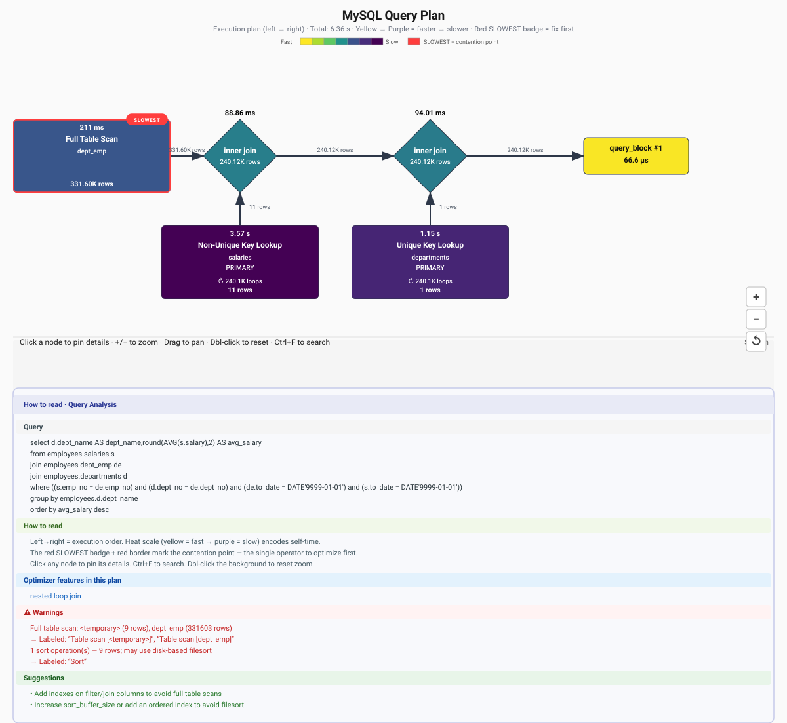

<p align="center">
  
</p>

# myflames

myflames is a local performance workspace and operational workbench for MySQL and MariaDB. It pairs execution plan visualizations (flame graphs, Visual Explain, execution trees, and plan diffs) with full-spectrum server diagnostics, lock contention analysis, a persistent SQL editor, and guarded server operations.

Inspired by [Brendan Gregg's FlameGraph](https://github.com/brendangregg/FlameGraph) and [Tanel Poder's SQL Plan FlameGraphs](https://tanelpoder.com/posts/visualizing-sql-plan-execution-time-with-flamegraphs/).



---

## Highlights

- **Plan Visualizations**: Four synchronized perspectives on the same query plan: Visual Explain, Flame Graph, Execution Tree, and Ranked Bar Chart.
- **Plan Comparisons**: Pair before and after plans to pinpoint operator regressions, cost changes, and row volume drifts.
- **Server Diagnostics**: Continuous health sampling, parsed InnoDB status, the server error log, table and file I/O statistics, wait event rankings, and full analysis reports.
- **Contention and Lock Tracking**: Track metadata lock blockers, waiting transactions, and deadlocks with single-session kill actions.
- **macOS app**: The workspace runs as an unsigned Apple Silicon desktop app with its own data, and the CLI stays available for scripts and CI.
- **Tuning**: A health scorecard and Full analysis for MySQL and MariaDB, with remediation SQL you can copy or open in the Query editor.
- **Query Editor**: SQL completion from the connected catalog, persistent tabs and sessions, transaction controls, cancellation, and schema browsing.
- **Table data**: Browse a table, stage row changes, review exact SQL, and apply a batch with stale-row checks. Tables without a supported reliable key remain read-only.
- **Guarded Operations**: Three-tier write-safety model (Production, Development, Read-only), shared CLI confirmation prompts, and an audited local trail.
- **Replication and Maintenance**: Monitor replication lag and recovery loops, run upgrade readiness checks, create and verify checksummed dumps, and perform live instance cloning.
- **Database diagram**: Rebuild an ER diagram from the connected database and import or export SQL, Mermaid, editable JSON and SVG.
- **Users and Roles**: Complete grant matrix supporting global, database, table, column, and routine scopes with batch review.
- **Agent and CI Ready**: Native Model Context Protocol (MCP) server, token-efficient plan digests, and exit-code validation gates.

---

Try a [MySQL plan demo](https://vgrippa.github.io/myflames/demos/live-mysql/live-mysql-derived-table-flamegraph.html) or a [MariaDB plan demo](https://vgrippa.github.io/myflames/demos/live-mariadb/live-mariadb-derived-table-flamegraph.html).

## Quick start

The workspace ships as a macOS desktop app. The Python package provides the command-line tools. Install either or both.

### 1. Install the macOS app (workspace)

1. Download `myflames-3.1.0-macos-arm64.zip` from the [GitHub release](https://github.com/vgrippa/myflames/releases) (Apple Silicon Macs).
2. Unzip it and move `myflames.app` to your Applications folder.
3. Open it from Finder. No terminal, Node.js or separately installed Python is needed.

The app is not signed with a Developer ID or notarized, so macOS blocks the first launch. Do one of the following once:

- Control-click `myflames.app`, choose **Open**, then **Open** again in the dialog.
- Or open **System Settings > Privacy & Security**, scroll to the message about myflames and choose **Open Anyway**.
- Or, from a terminal, remove the quarantine flag: `xattr -dr com.apple.quarantine /Applications/myflames.app`

Where it keeps its data: under `~/Library/Application Support/myflames-desktop`, separate from the CLI's `~/.myflames`. Connections and saved passwords added in the CLI do not appear in the app, and the reverse. The minimum window size is 720 by 520 pixels.

How it finds database clients: the app does not bundle `mysql`, `mariadb`, MySQL Shell or dump tools. It looks in your PATH and in the standard macOS locations (Homebrew under `/opt/homebrew` and `/usr/local`, Oracle MySQL under `/usr/local/mysql/bin`, and MacPorts under `/opt/local/bin`), so Finder launches work without shell startup files. Install a client, for example `brew install mysql-client`, and use Maintenance > Detect tools to confirm it is found.

There is no browser version of the workspace. See [Desktop app](docs/DESKTOP.md) for building the app from source.

### 2. Install the command-line tools

Install via pipx:

```bash
pipx install myflames
```

Or install with pip in any Python 3.7+ environment:

```bash
pip install myflames
```

The CLI works on its own. It is also the engine behind the app, and it keeps its own data in `~/.myflames`.

### 3. `myflames ui` is deprecated

`myflames ui` starts the old browser workspace. It is deprecated in favor of the macOS app, and prints a warning to stderr. The desktop app uses it internally as its backend launcher.

```bash
myflames ui
```

It prints a one-time local launch URL on `127.0.0.1`:

```
warning: 'myflames ui' (browser workspace) is deprecated; use the standalone desktop application (myflames.app).
myflames UI: http://127.0.0.1:8765/#launch=<token>
```

- `--no-browser` runs without opening a browser window (used by backend launchers).
- `--port 8765` selects a local port.
- `--no-restore` starts without restoring saved sessions.

---

## Engine compatibility

The core package requires Python 3.7+ and standard library modules only. Live database interactions require a local `mysql` or `mariadb` client binary in your PATH (the macOS app also searches the standard Homebrew, Oracle MySQL and MacPorts locations).

| Database engine | Plan views and analysis | Server diagnostics and sessions | Guarded operations |
| --- | --- | --- | --- |
| **MySQL 8.0** | Estimated JSON plans. Timed JSON plans require format version 2 (available in 8.3+). | Health, InnoDB status, Error log (8.0.22+), Sessions, Locks, Top statements, Waits, I/O. | Write policies, audit logging, variable management, dumps, and user administration. |
| **MySQL 8.4 & 9.x** | Estimated and timed JSON plans (`FORMAT=JSON` v2), optimizer traces, and cost breakdowns. | Complete Performance Schema coverage, session plans, and resource metrics. | Full suite: CLONE instance, replication skips, variable persistence (`SET PERSIST`), and upgrade checks. |
| **MariaDB 10.11+** | Estimated JSON plans and measured `ANALYZE FORMAT=JSON` plans, normalized automatically. | Health, InnoDB status, Sessions, Waits (via User Statistics), Schema metrics, and the error log file when the server runs on the same computer. | Dumps and restores, replication skips, and role management. Option file guidance for server variables. |

---

## Key capabilities

### 1. Analyze execution plans

Inspect plans through four coordinated views:

- **Visual Explain (`--type workbench`)**: Diagram showing data flow, join methods, table access paths, and row volumes.
- **Flame Graph (`--type flamegraph`)**: Execution time distribution across nested query operations.
- **Execution Tree (`--type tree`)**: Collapsible tree detailing operator costs, row counts, and engine conditions.
- **Bar Chart (`--type bargraph`)**: Operators ranked by self time to isolate bottlenecks immediately.

Capture plans directly from the command line:

```bash
# Capture an estimated query plan
myflames capture --profile prod -e 'SELECT * FROM orders WHERE id = 100' -o plan.json

# Capture a measured execution plan with repeated runs and optimizer trace
myflames capture --profile prod -e 'SELECT * FROM orders WHERE id = 100' \
  --mode analyze --repeat 3 --timeout 30 --trace -o measured.json

# Export an interactive HTML visualization
myflames measured.json --type workbench -o plan.html
```

Compare two plans to evaluate optimizations or engine upgrades:

```bash
myflames compare before.json after.json -o comparison.html
myflames compare before.json after.json --json
```

### 2. Server diagnostics and contention analysis

Connect to a live server to identify system-wide bottlenecks:

- **Full Analysis Report**: Run health checks across storage engines, buffer pool efficiency, indexing, and configuration settings:
  ```bash
  myflames report --profile prod --html -o server-report.html
  ```
- **Top Statements**: Rank statement digests from Performance Schema by total time, average latency, full scans, or examined rows:
  ```bash
  myflames top --profile prod --order avg --limit 10
  ```
- **Locks and Deadlocks**: Inspect blocking metadata locks, row lock waits, and recent InnoDB deadlocks:
  ```bash
  myflames locks --profile prod --waits-only
  ```
- **Database Diagrams**: Visualize schemas and foreign-key relationships from live metadata or imported SQL, Mermaid, or JSON files without executing queries.

Top statements opens selected SQL and its evidence across the available width. Supported UPDATE, DELETE and INSERT/REPLACE SELECT statements can be converted to a SELECT for review before analysis. This measures row selection or the SELECT source only; it does not reproduce write cost, assignment expressions, triggers or locking. Unsupported forms remain blocked.

### 3. Query editor and persistent SQL sessions

The workspace includes a SQL editor built on dedicated server sessions:

- Session affinity retains session variables, temporary tables, and transaction states across executions.
- Multi-statement execution with statement splitting and cursor-sensitive execution.
- Safe updates enabled by default for Production connections.
- Transaction controls with visual indicators for open transactions, commit, and rollback.
- Statement cancellation using `KILL QUERY` without dropping the underlying connection.
- Export results to CSV, JSON, TSV, Markdown, or SQL INSERT statements.

Run SQL scripts from the command line using the same safety checks:

```bash
myflames sql --profile prod -e 'SELECT * FROM shop.orders LIMIT 10'
myflames sql --profile dev -f schema.sql --yes --format csv -o out.csv
myflames sql --profile prod -e 'SELECT * FROM shop.orders' --format insert --insert-table orders -o dump.sql
```

### 4. Write-safety model and audit trail

Every connection is assigned a safety policy:

- **Production**: All write operations require explicit review and confirmation.
- **Development**: DDL, administrative actions, and unbounded writes require confirmation; ordinary key-scoped writes proceed directly.
- **Read-only**: All mutations, DDL, and administrative calls are strictly refused.

```bash
# Set connection policies
myflames profiles set prod --read-only
myflames profiles set staging --type development

# Review the local audit trail
myflames audit --since 7
myflames audit export --csv -o audit.csv
```

Optional Optimize table and Apply instrumentation actions show their exact SQL and require confirmation, including on Development connections. Reusable InnoDB free space stays informational; it does not imply that maintenance is needed.

All mutations are logged to a local SQLite database (`~/.myflames/workspace.sqlite3`) with passwords and sensitive credentials automatically redacted.

### 5. Replication, lifecycle, and administration

- **Replication Monitoring and Recovery**: Review channel status, GTID sets, and worker lag caveats. Plan a single transaction skip or an error-capped skip loop (`myflames replication skip`).
- **Upgrade Checking**: Validate compatibility against target versions with MySQL Shell or native checks (`myflames upgrade-check`).
- **Backup and Restore**: Generate checksummed dumps and perform verified restores (`myflames dump`, `myflames restore`). In Maintenance, choose a folder with the system dialog and review the selected tool's compression, chunking and object options before starting. File encryption requires an encrypted destination or a separate tool.
- **Local tools**: Open official download pages and check for newer releases with Detect tools or Refresh. Server client checks stay within the installed release series; MySQL Shell checks its latest GA release. Offline checks remain unknown.
- **Instance Cloning**: Automate `CLONE INSTANCE` from a donor server with strict TLS verification on the recipient (`myflames clone`).
- **Users and Roles**: Inspect effective account grants, edit privileges across scopes, manage roles, and review statement batches before applying (`myflames accounts`, `myflames privileges`).

### 6. Automation, CI, and AI agents

Integrate myflames into automation pipelines and AI tooling. CLI tool discovery stays offline; the workspace opts into vendor update checks. The `tables` and full-report commands treat reusable InnoDB free space as information, so it does not trigger a warning exit code by itself:

- **CI Exit-Code Gates**: Fail builds on query anti-patterns or server warnings:
  ```bash
  myflames check explain.json --fail-on full_scan,filesort
  myflames report --profile prod --fail-on problem -q
  ```
- **Compact Plan Digests**: Produce token-cheap plan summaries for LLMs:
  ```bash
  myflames digest explain.json
  myflames digest explain.json --cost
  ```
- **Model Context Protocol (MCP)**: Run the native MCP server to provide read-only diagnostic tools (`analyze_plan`, `server_report`, `top_statements`, `locks_report`) to AI agents over stdio:
  ```bash
  pip install 'myflames[mcp]'
  myflames-mcp
  ```

---

## CLI reference

Invoke subcommands with `myflames <command>` or `python3 -m myflames <command>`.

| Command | Primary options | Purpose |
| --- | --- | --- |
| `ui` | `[--port PORT] [--no-browser] [--no-restore]` | Deprecated: launch the browser performance workspace (use the macOS app, `myflames.app`). |
| `sql` | `[-e SQL \| -f FILE] [--format FORMAT] [--insert-table NAME] [-o PATH] [--yes]` | Run SQL statements inside an editor session with safety policies. Results carry no column types, so JSON keeps numbers as strings, table quotes them and INSERT writes them as quoted text (NULL stays NULL). |
| `capture` | `[-e SQL \| --statement-digest HASH] [--mode {explain,analyze}] [--trace] [-o PATH]` | Capture estimated or analyzed plans and metadata as JSON. |
| `explore` | `PLAN [--type TYPE] [--metric METRIC] [--focus ID] [-o PATH]` | Export an interactive plan visualization HTML file. |
| `compare` | `before.json after.json [--digest \| --json] [-o PATH]` | Compare two execution plans and report operator differences. |
| `diff` | `before.json after.json [--digest \| --json] [-o PATH]` | Deprecated alias of `compare`. |
| `top` | `[--order {total,time,avg,examined,rows,count,exec_count,full_join,scan,scans,no_index,tmp_tables,locks}] [--table SCHEMA.TABLE] [--schema NAME] [--limit N] [--json] [-o PATH] [-q]` | Rank expensive statements from Performance Schema digests. |
| `sessions` | `[--min-seconds N] [--kill ID [--yes]] [--explain ID]` | Inspect running queries, idle transactions, and thread states. |
| `running` | `[--min-seconds N] [--explain ID] [--json] [-o PATH]` | Deprecated alias of `sessions`, retaining the `running-1.0` contract. |
| `locks` | `[--waits-only \| --deadlock \| --kill ID [--yes]]` | Trace lock waits, metadata blockers, and deadlocks. |
| `health` | `[--interval N] [--fail-on {problem,watch}]` | Sample server status counters over time to detect health anomalies. |
| `innodb` | `[--raw] [--fail-on {problem,watch}]` | Parse and summarize SHOW ENGINE INNODB STATUS output. |
| `error-log` | `[--level LEVEL[,LEVEL...]] [--limit N] [--fail-on {problem,watch}]` | Read the server error log: `performance_schema.error_log` on MySQL; on MariaDB the log file, only when the server runs on this computer. |
| `waits` | `[--interval N] [--limit N]` | Rank wait events over a sampling window and since server boot. |
| `indexes` | `[--schema NAME] [--all-schemas] [--limit N]` | Find unused, redundant, or missing indexes. |
| `tables` | `[--schema NAME] [--all-schemas] [--fresh]` | Inspect table fragmentation, missing primary keys, and engine distributions. |
| `io` | `[--interval N] [--schema NAME] [--all-instances]` | Analyze file and table I/O throughput. |
| `config` | `[--fail-on LEVEL]`; `set NAME VAL [--persist]`; `reset-persist NAME` | Review server settings or execute planned variable modifications. |
| `instruments`| `[--preset {minimal,locks,waits,defaults}]` | Review Performance Schema instrumentation and generate setup SQL. |
| `report` | `[--interval N] [--schema NAME] [--html \| --json \| --markdown]` | Generate a full server analysis report across all diagnostic modules. |
| `replication`| `[--channel NAME]`; `skip [--yes]`; `skip-loop --errors CODES` | Monitor replica lag and manage transaction skip recovery loops. |
| `accounts` | `list`, `show`, `create`, `drop`, `grant`, `revoke`, `role` | Inspect and manage users, roles, passwords, and privileges. |
| `privileges` | `[--json]` | Report effective permissions and per-action verification status. |
| `upgrade-check`| `--target-version X.Y.Z [--no-shell]` | Run MySQL Shell upgrade checks or native compatibility checks. |
| `dump` | `DIRECTORY [--schema NAME] [--threads N] [--yes]` | Create a consistent database dump with checksum manifests. |
| `restore` | `DIRECTORY [--confirm-target TARGET] [--yes]` | Restore a validated dump and verify record counts. |
| `clone` | `--donor-profile NAME [--confirm-target TARGET] [--yes]` | Clone a remote MySQL instance to the connected recipient. |
| `profiles` | `list`, `set NAME [--type TYPE] [--read-only]`, `delete NAME` | Manage saved database connection profiles and safety settings. |
| `audit` | `list [--since DAYS]`, `export [--csv]`, `purge [--older-than DAYS]` | Query and maintain the local server write audit trail. |
| `check` | `PLAN [--fail-on LIST] [--ignore LIST]` | Validate plans against rule thresholds with automated exit codes. |
| `advise` | `PLAN [--ignore LIST] [--json]` | Provide ranked optimization suggestions for an execution plan. |
| `findings` | `PLAN [--ignore LIST] [--json] [-o PATH]` | Deprecated alias of `advise`. |
| `digest` | `[PLAN] [--cost] [--tokenizer {heuristic,claude,gpt}]` | Output concise plan summaries and LLM token cost estimates. |
| `tokens` | `PLAN [--cost] [--json] [--show] [-o PATH]` | Deprecated alias of `digest`, defaulting to `--cost`. |
| `import-shell` | `BUNDLE [--query N] [--list] [-o PATH] [-q]` | Convert a MySQL Shell diagnostics ZIP into capture JSON. |
| `guide` | `[-o PATH] [-q]` | Show which visualization to choose for a use case. |
| `teach` | `[{btree,bnl,hash,join,lru}] [--index \| --catalog] [--title TITLE] [-o PATH] [-q]` | Render interactive architectural and algorithmic database lessons. |

| Connection option | Purpose |
| --- | --- |
| `--profile NAME_OR_ID` | Use a saved connection for live commands, including capture, sql, top, sessions, report, replication and lifecycle operations. |
| `-h HOST`, `-P PORT`, `-u USER`, `-D DATABASE` | Set the server address, port, user and default database. |
| `-p` | Prompt for a password without putting it on the command line. |

Connection parameters (`--profile NAME`, `-h HOST`, `-P PORT`, `-u USER`, `-p`, `-D DATABASE`, `--ssl-mode MODE`) are accepted across all live commands. Pass `-p` without a value to prompt securely for passwords.

---

## Documentation

- [Workspace and Server Guide](docs/LOCAL_UI.md): In-depth guide to navigation, Server views, and security.
- [Query Investigations and SQL Sessions](docs/QUERY_WORKSPACE.md): Captures, comparisons, and workbench workflows.
- [Visual Explain Reference](docs/VISUAL_EXPLAIN_REFERENCE.md): Operator symbols, join types, and metrics.
- [Developer Reference](docs/DEVELOPER_REFERENCE.md): Architecture, CLI contracts, APIs, and engine matrix.
- [Changelog](CHANGELOG.md): History of features, fixes, and version releases.

---

## License and credits

myflames is licensed under the [Apache-2.0 License](LICENSE). Detailed attribution and licensing history are preserved in the [NOTICE](NOTICE) file.

Brendan Gregg's FlameGraph and Tanel Poder's SQL Plan FlameGraphs are the original inspiration for this work. The optional 3D B+tree lesson is inspired by [PGSimCity](https://github.com/NikolayS/PGSimCity) by Nikolay Samokhvalov.

### Workspace navigation and settings

Home shows the installed version, a release link, and shortcuts to SQL, Server and database diagrams. Query editor and Plans sit together under SQL workspace. Database diagram includes a Diagram | Mermaid switch that renders the Mermaid ER diagram beside its code. Refresh all reads every Server section, including unopened sections, with bounded concurrency; a view reads when opened on screen (once per connection, while Tables and Indexes keep their schema-size consent and Error log waits for Load).

Parameters (under Server > Setup) lists every global server parameter in one filterable table modelled on an AWS RDS parameter group. Edit turns supported dynamic and persistable static values into inline controls, Preview changes summarizes staged edits, and Review and apply plans and confirms up to 25 changes in one batch with per-row re-reads and audit records. The inspector also offers Reset to default, single-parameter Change… (including This session only, which opens the statement in the Query editor) and Reset persisted value…. Permission details appear inside the review dialog.

Instruments lets you filter and select individual instruments or consumers and apply batched `UPDATE` statements through the reviewed SQL runner, with copy-only option file lines for restart persistence. Learn matches the workspace light and dark appearance, with a lesson toolbar, grouped family rows, and a compact embedded lesson bar.

Tables and Indexes include complete scoped inventories with pagination. Export the filtered results as CSV, HTML or PDF through the system print dialog. Tables can filter measured reusable-space percentage; this is not an index fragmentation estimate.
