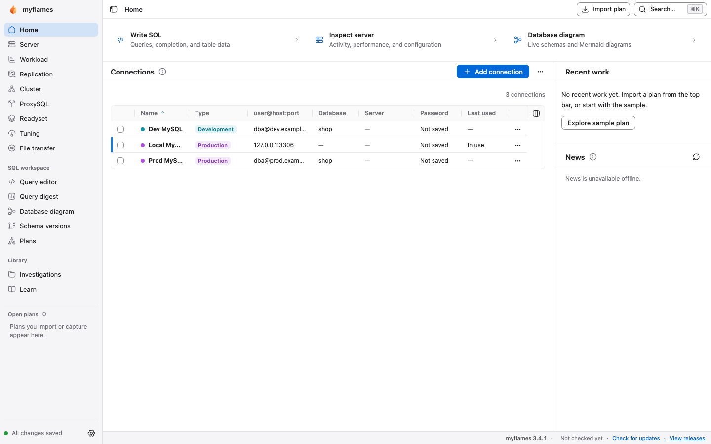
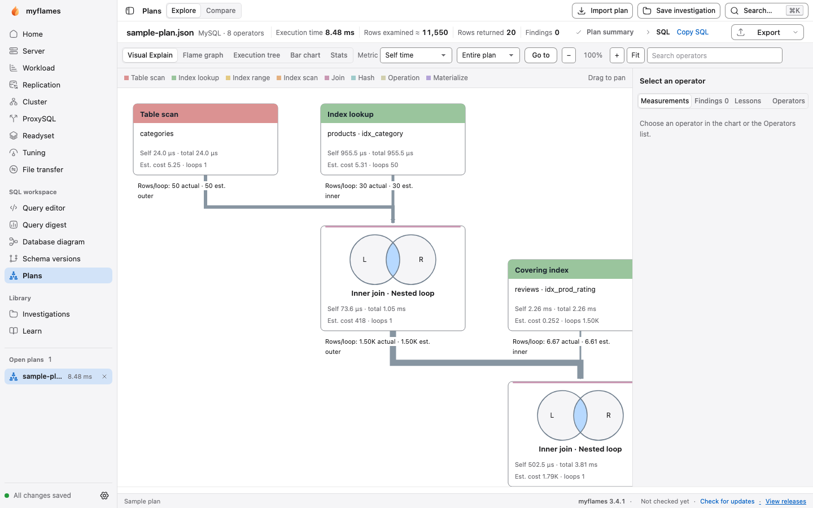
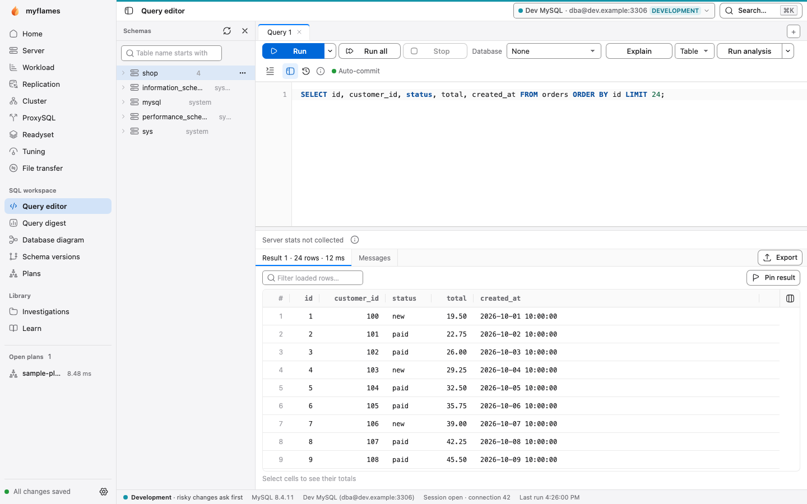
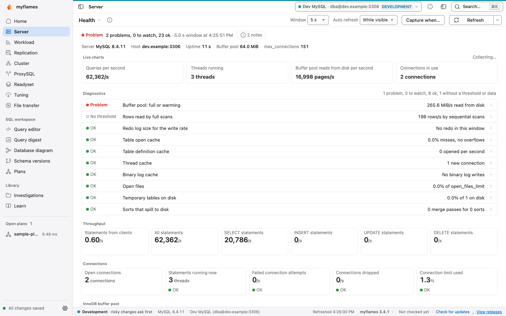

<p align="center">
  
</p>

<h1 align="center">myflames</h1>

<p align="center"><strong>See what your database is doing.</strong></p>

<p align="center">
  <a href="https://github.com/vgrippa/myflames/releases/latest">Download</a> ·
  <a href="#documentation">Documentation</a> ·
  <a href="docs/brand/README.md">Logo &amp; mascot</a>
</p>

**myflames** is an open-source performance workspace for MySQL, MariaDB, and Percona Server for MySQL. Follow a question from the query plan to the SQL, schema, and server behind it. Inspect operator timings, compare before and after plans, and share the evidence with your team.

Use the desktop app on macOS or the Windows x64 preview, or take the same engine into your terminal with a Python CLI that uses only the standard library. Visual Explain diagrams, flame graphs, execution trees, and bar charts make plans easier to read; server diagnostics, CI checks, and read-only MCP tools carry the investigation further.

Inspired by [Brendan Gregg's FlameGraph](https://github.com/brendangregg/FlameGraph) and [Tanel Poder's SQL Plan FlameGraphs](https://tanelpoder.com/posts/visualizing-sql-plan-execution-time-with-flamegraphs/).

## Screenshots









Try a [MySQL plan demo](https://vgrippa.github.io/myflames/demos/live-mysql/live-mysql-derived-table-flamegraph.html) or a [MariaDB plan demo](https://vgrippa.github.io/myflames/demos/live-mariadb/live-mariadb-derived-table-flamegraph.html) in your browser.

## Highlights

- **Plans and plan comparison**: Inspect `EXPLAIN ANALYZE FORMAT=JSON` and `EXPLAIN FORMAT=JSON` plans as Visual Explain diagrams, flame graphs, execution trees or bar charts, with ranked findings, operator search and interactive algorithm lessons in Learn (each one steps through the algorithm with simplified code beside the drawing and ends with a short quiz). Save captures into Investigations and compare before and after plans side by side in Compare. Flame graph color intensity follows each frame’s own measured time, with neutral frames when timing is unavailable. Workspace startup restores quietly; Settings > Start fresh opens a confirmation to reset the workspace. The Stats view totals time per table and per operator type, **All occurrences** gathers every place one operator appears, and exports can hide literal values before you share a plan.
- **Query editor, Query digest and Database diagram**: Run SQL across multiple tabs with dedicated sessions, schema and column completion, SQL formatting, parameter binding with a fill-in form for digest values, saved queries in folders, exact totals of the selected cells, a row panel with JSON laid out, editable InnoDB table data and CSV, JSON, SQL or Markdown export. A plan that needs the tab's session (a temporary table, a user variable, a prepared statement) can be captured in that session instead of failing. Before an ALTER TABLE runs, its review predicts whether the server will run it INSTANT, INPLACE (with or without a table rebuild) or COPY, and whether writes can continue, with the reason for each clause. Summarize statement digests in Query digest, ranked against the server's total statement time, with P95, P99 and P99.9, a latency histogram and CPU time on MySQL, and the size and indexes of the tables a statement names, and inspect or export entity-relationship diagrams in Database diagram. Query digest has a **Source** choice: Statement digests (Performance Schema), **Slow log table** (`mysql.slow_log`) or **Slow log file** (a MySQL 5.7 to 9.x, Percona Server or MariaDB slow query log on this computer, summed by statement fingerprint with no server), and a **Time range** with a calendar and quick ranges.
- **Import CSV**: Load a .csv, .tsv or .txt file into an existing table or a new one, from the Query editor's Schemas panel (a table's menu: **Import CSV…**; a database's menu: **Import CSV into a new table…**) or from Server > Tables (row menu and inspector). The sheet detects the separator, encoding and header row, checks every row against the column types before anything is sent, and lists problems by line. Rows go as batched INSERT statements by default; LOAD DATA LOCAL is offered only when the server already has `local_infile` ON, and myflames never changes that setting. If a row fails or you stop the import, you choose to keep nothing (one rolled-back transaction) or to keep the rows committed every N rows, and bad rows can stop the import or be skipped and reported. Every import is a reviewed and audited write, and the Audit log never stores row data. There is no CLI for Import CSV.
- **Schema versions**: Save the schema of a database on this computer and compare any two schemas: saved versions, exported files, or databases read now, on the same server or on different ones. A comparison has a source, the schema to match, and a target, the schema that would change: each object is listed as different, only in the source or only in the target (columns, keys, foreign keys, options, partitioning, views, routines, triggers, events), with both definitions side by side and the sync script that would change the target to match the source, ready to review, copy or open in the Query editor. You choose which objects the script includes (objects only in the target are left out until you choose them; changes within a chosen object can still drop columns or replace the object, and they carry a `-- WARNING:` comment and the Drops data label), each change says whether it drops data, may fail on existing rows or rebuilds the table (each ALTER TABLE carries its predicted INSTANT, INPLACE or COPY algorithm as a comment), and **Checks** flag risky definitions such as FLOAT money columns, utf8mb3, MyISAM or a foreign key without an index. myflames never runs the script. **Export as SQL…** turns a saved version, or a database read now, into a script that recreates the schema on another server (tables in foreign key order, definers left out unless you keep them); it is never run either.
- **Server views and Tuning**: Check live metrics in Health (with live charts, and **Capture when…** to save the processlist, InnoDB status and locks into an investigation when threads pile up or a lock wait or statement runs long), InnoDB, Error log, Waits, I/O, Indexes, Tables, Parameters (linked to official MySQL, MariaDB and Percona manuals) and Instruments, or refresh all views at once. Compare parameters between two servers or against a saved snapshot, and in **Versions** compare two MySQL or MariaDB releases, or trace one parameter through every cataloged release, from catalogs shipped with myflames. Open Tuning for configuration checks and the Full analysis report. **Table structure** in Tables shows one table's columns, indexes, foreign keys and exact `SHOW CREATE TABLE`.
- **Files**: Move logs, dumps and configuration files between this computer and your servers over SSH/SFTP, in a place of its own with two panes side by side (this computer and the server), like FileZilla. Save **SSH connections** of their own (host, port, user, and sign-in with your SSH agent, a key file with an optional passphrase, or a password), started from a database connection or a `~/.ssh/config` alias; a password or passphrase you save is kept in the platform credential store. The first connection to a server shows its host key fingerprint to compare before you trust it; myflames keeps trusted keys in its own file and never edits `~/.ssh/known_hosts`. Browse with breadcrumbs, a filter, sorting and Finder-style selection; drag files and folders between the panes or from the Finder; create, rename and delete; and follow every transfer (folders included) with progress, rate, time left, Cancel and Retry. Downloads are staged so a stopped one never leaves a half-written file.
- **Processlist and Locks**: Inspect active connections, open transactions and running queries in Processlist, follow the stage, percentage and time left of a running ALTER TABLE, explain a live session's statement, or end runaway queries with single or bulk Kill. Trace blocking trees, waiting DDL, metadata locks, InnoDB row locks and the latest deadlock in Locks. Ages and waits use readable durations; exact seconds are on hover in duration tables, Processlist detail facts and Locks summary facts (see [the workspace guide](docs/LOCAL_UI.md)).
- **Replication, Cluster, ProxySQL and Readyset**: Explore dimensional multi-tier topology views spanning ProxySQL, Readyset and MySQL or MariaDB standalone servers, replicas and clusters, with selectable nodes, connection switching and cross-place navigation. Monitor replica channels, GTID positions, applier workers and lag in Replication, and skip one failed transaction or run a bounded skip loop after review. Inspect MariaDB Galera, Percona XtraDB Cluster, MySQL InnoDB Cluster and Group Replication topology and member actions in Cluster, inspect backend pools, QueryPilot rules and digests in ProxySQL, or inspect Readyset shallow and deep caches, cached versus upstream latency percentiles, proxied query cacheability (`EXPLAIN CREATE CACHE`), base-table CDC replication, re-snapshotting and dynamic `ALTER READYSET` parameters in Readyset.
- **Users and roles**: List accounts and roles without exposing password hashes, inspect effective grants and privileges, and create, drop, rename, lock, expire passwords or change grants and roles after reviewing the exact SQL and before-and-after grant diff. Compare accounts between two servers and export the chosen accounts' grants as SQL without passwords.
- **Maintenance**: Detect local client tools (`mysqlsh`, `mysqldump`, `mariadb-dump` and others), run pre-upgrade checks, and run preflighted dumps, restores and MySQL `CLONE` jobs with progress, cancellation and manifest verification.
- **Connections, write safety and the audit log**: Every connection is Production (confirms every change), Development (confirms risky changes such as DDL, `KILL`, `SET GLOBAL`, replication skips and `CLONE`) or Read-only (refuses all changes before connecting), shown as a strip along the top of the window and on every review sheet. A connection can reach its server through an SSH tunnel with your own `~/.ssh/config`, keys and agent. Every confirmed, refused or declined change is recorded in the local Audit log (`Settings > Audit log` or `myflames audit`) without passwords.
- **CLI, CI gates and MCP for agents**: Generate standalone SVG or HTML reports, compare plans, emit compact text digests (`myflames digest`), gate pull requests on plan rules or server checks (`--fail-on`), or expose read-only analysis and live inspection tools to AI agents with `myflames-mcp`.

## Install

### macOS app

1. Download `myflames-3.3.2-macos-arm64.dmg` from [GitHub Releases](https://github.com/vgrippa/myflames/releases) (Apple Silicon), open it, and drag `myflames.app` to `/Applications`.
2. Double-click `myflames.app`. It is signed with a Developer ID and notarized by Apple, so macOS opens it without extra steps. Releases before 3.3.0 were unsigned zips: Control-click those in Finder and choose **Open** the first time.

The packaged app keeps its data under `~/Library/Application Support/myflames-desktop`, unless overridden by `MYFLAMES_DESKTOP_DATA`. Its workspace database and audit records are in `backend-home/.myflames/workspace.sqlite3`; saved passwords use `credentials.vault` and `vault.key` in that same `.myflames` folder, and SSH host keys you trust in **Files** are kept in `ssh_known_hosts` there. Desktop and CLI data are separate; the CLI uses `~/.myflames`. You can check for newer releases on demand with **Check for updates** on Home or in **Settings > About myflames**.

### Windows app (preview)

1. Download `myflames-3.3.2-windows-x64-setup.exe` from [GitHub Releases](https://github.com/vgrippa/myflames/releases) and run it. It installs for your user only, with no administrator prompt, and adds Start menu and desktop shortcuts.
2. The installer is not code signed yet, so SmartScreen says "Windows protected your PC" the first time: choose **More info**, then **Run anyway**.

The Windows app is a preview: it has been tested on Windows 11 x64, but a crash can leave a statement that was already running on the server until it finishes. SSH tunnels end with the app however it stops; a dump, restore or clone that was running when the app crashed keeps going until it finishes. In **Files**, Windows can browse servers and folders, sign in with the SSH agent or a key without a passphrase, and rename, create and delete on the server, but uploads and downloads are not available yet (their safe local file handling needs macOS or Linux). Its data lives in `%APPDATA%\myflames-desktop`. Uninstall it from **Settings > Apps**.

Live server features use a local `mysql` or `mariadb` client and optional `mysqlsh`, `mysqldump` or `mariadb-dump` binaries. The app discovers them automatically on `PATH` and in standard Homebrew, MacPorts and vendor folders (`/opt/homebrew/bin`, `/usr/local/bin`, `/opt/local/bin`, `/usr/local/mysql/bin`); on Windows, in the folders the MySQL and MariaDB installers create under Program Files.

While Home is open, the app fetches up to six headlines from Planet MySQL and the MariaDB Foundation over HTTPS and caches them for six hours. Turn this off in **Settings** with **Show MySQL and MariaDB news on Home**; nothing is fetched while it is off.

### Python CLI

The CLI requires Python 3.7 or later and uses the Python standard library only.

```bash
pipx install myflames
# or: pip install myflames
```

From a source checkout, run `python3 myflames.py` or `python3 -m myflames` directly.

## Engine compatibility

| Capability | MySQL 5.7 | MySQL 8.0 | MySQL 8.4 and 9.x | MariaDB 10.11+ and 11.x | Percona Server 8.0 and 8.4 / PXC |
| :--- | :--- | :--- | :--- | :--- | :--- |
| **Offline plan files** | `EXPLAIN FORMAT=JSON` (the `query_block` format; no operator timing) | `EXPLAIN FORMAT=JSON` (cost estimates; no operator timing) | `EXPLAIN ANALYZE FORMAT=JSON` and `EXPLAIN FORMAT=JSON` | `ANALYZE FORMAT=JSON` and `EXPLAIN FORMAT=JSON` | 8.0: `EXPLAIN FORMAT=JSON`; 8.4: `EXPLAIN ANALYZE FORMAT=JSON` |
| **Live plan capture (`capture`, `-e`, Explain)** | Estimated plans only (`EXPLAIN FORMAT=JSON`); Run analysis and root `-e` analysis are refused because 5.7 has no `EXPLAIN ANALYZE` | `EXPLAIN FORMAT=JSON` with `capture --mode explain`; Run analysis and root `-e` analysis are refused before sending (`EXPLAIN ANALYZE FORMAT=JSON` is 8.3+) | Estimated and timed plans, schema, statistics, variables and trace | Estimated and timed plans, schema, statistics, variables and trace | 8.0: `EXPLAIN FORMAT=JSON`; 8.4: `EXPLAIN ANALYZE FORMAT=JSON` |
| **Query editor, Query digest, Database diagram** | SQL sessions and schema diagrams; Query digest Statement digests have no sample text, quantiles or CPU time on 5.7, and the Slow log table and Slow log file sources work | SQL sessions, digest summaries and schema diagrams | SQL sessions, digest summaries and schema diagrams | SQL sessions, digest summaries and schema diagrams | SQL sessions, digest summaries and schema diagrams |
| **Schema versions** | Read, compare, sync script and Export as SQL; Checks leave reserved words Not judged before 8.0.11 | Tables, views, routines, triggers and events from `SHOW CREATE`; sync script; Checks (current reserved words need a live 8.0.11+ connection) | Same (JavaScript libraries of 9.2+ are not read) | Same, plus sequences, packages and system-versioned tables (sequence and versioning changes are listed but not generated); Checks leave reserved words Not judged | Same as MySQL |
| **Server views, Processlist, Locks, Tuning** | Server diagnostics; Locks reads `INNODB_LOCKS` and `INNODB_LOCK_WAITS`; Error log gets file guidance; Parameters have no sources and no `SET PERSIST` | Server diagnostics; `performance_schema.error_log` requires 8.0.22+; older 8.0 gets file-viewing guidance | Server diagnostics | `userstat` fallbacks for index usage and table I/O when enabled; Waits requires Performance Schema. `metadata_lock_info` for MDL; verified local error log file or guidance | Server diagnostics plus Percona `userstat` index and table stats, thread-pool metrics, `log_slow_rate_limit` checks and Percona parameter links |
| **Replication and Cluster** | Replication (`SHOW SLAVE STATUS`), Group Replication from 5.7.17; reviewed Cluster changes need 8.0.13 | Replication (`SHOW REPLICA STATUS` / `SHOW SLAVE STATUS`), InnoDB Cluster, Group Replication | Replication (`SHOW REPLICA STATUS`), InnoDB Cluster, Group Replication | Replication (`SHOW ALL SLAVES STATUS`, `gtid_slave_pos`), MariaDB Galera Cluster | MySQL Replication, Group Replication, Percona XtraDB Cluster (`wsrep_*`, `pxc_cluster_view`) |
| **Users and roles** | Users only (5.7.6+); no roles | Users, roles, default roles, partial revokes and dynamic privileges | Users, roles, default roles, partial revokes and dynamic privileges | Users, MariaDB roles, `SET DEFAULT ROLE` and `PUBLIC` | MySQL privilege and role model |
| **Maintenance** | Upgrade check, dump and restore (structure only included); no `CLONE` | Upgrade check (`mysqlsh` or partial native subset), dump, restore, `CLONE` (8.0.17+) | Upgrade check, dump, restore, `CLONE` | Dump and restore (`mariadb-dump`); points to `mariadb-upgrade` and `mariadb-backup` for upgrades and physical copies | Upgrade check, dump, restore, `CLONE` (Percona Server) |

For manual MySQL JSON generation on 8.3+, select format version 2 with `SET SESSION explain_json_format_version=2` before EXPLAIN. Timed JSON analysis needs MySQL 8.3 or later (8.4 LTS); on earlier versions myflames refuses it before sending anything. MySQL 5.7 is end of life; myflames reads it and says in plain sentences what 5.7 lacks (roles, `SET PERSIST`, `EXPLAIN ANALYZE`, `CLONE`, `performance_schema.error_log`, invisible indexes). A MySQL 5.6 or older server gets a note that results may be missing or wrong.

ProxySQL 2.x and 3.x are supported in the ProxySQL place when connected to a ProxySQL Admin interface. Readyset is supported in the Readyset place, `myflames readyset` and `myflames-mcp` (`readyset_status`) when connected to a Readyset SQL listener (default port 3307) or admin SQL listener (default port 6036).

## CLI examples

Live examples assume saved `prod` and `dev` profiles and an `orders` table. `before.json` and `after.json` are captures from before and after a change; `explain.json` below can be either capture or an exported plan.

Capture a live plan with schema, table statistics and session variables, then render a self-contained HTML report:

```bash
myflames capture -p --profile prod -e "SELECT * FROM orders WHERE customer_id = 42" -o before.json
myflames --type workbench before.json -o plan.html
```

Compare two plans in an HTML diff or a compact text diff:

```bash
myflames compare before.json after.json -o diff.html
myflames compare before.json after.json --digest
```

Run a full server analysis report or list the heaviest statements from Performance Schema:

```bash
myflames report -p --profile prod --html -o server-report.html
myflames top -p --profile prod --order total --limit 25
```

Save a database's schema as a version, then compare that version with the database later, or compare the same database on two servers. The first side is the source (the schema to match) and the second the target: the sync script changes the target to match the source, and it is printed, never run:

```bash
myflames schema save -p --profile prod -D shop --name "before release 42"
myflames schema compare latest live -p --profile prod -D shop
myflames schema compare profile:prod/shop profile:staging/shop --sql -o sync-staging.sql
myflames schema lint live -p --profile prod -D shop
myflames schema export latest --sql --create-database -o shop.sql   # a script that recreates the schema; never run
```

Sum a slow query log by statement fingerprint (a file from MySQL 5.7 to 9.x, Percona Server or MariaDB, or `mysql.slow_log` with `--table`), optionally within a time range, with no server needed for a file:

```bash
myflames slow-log /var/log/mysql/slow.log --from '2026-10-31 09:00' --to '2026-10-31 10:00'
myflames slow-log --table --profile prod --order avg --limit 10
```

Dump only the definitions, without rows:

```bash
myflames dump backup-structure --no-data --schema shop --profile prod
```

The sync script leaves out objects that exist only in the target; add `--include-drops` to drop them, or name the objects to include with `--only KEY` (the `key` of each object in `--json`). Each `ALTER TABLE` in it carries an `-- ALGORITHM:` comment with the predicted INSTANT, INPLACE or COPY algorithm and whether writes wait, from the target's saved definition; no ALGORITHM or LOCK clause is added.

Compare global parameters or accounts between two servers, keep a parameter snapshot to compare later, and export grants as SQL without passwords (nothing is run):

```bash
myflames config snapshot save -p --profile prod --label "before upgrade"
myflames config compare profile:prod profile:staging
myflames config compare latest profile:prod
myflames accounts compare profile:prod profile:staging
myflames accounts export profile:prod --account 'app'@'10.0.%' -o grants.sql
```

Compare the parameter catalogs of two server releases, or trace one parameter through every cataloged release. The catalogs ship with myflames and no server is read:

```bash
myflames config versions list
myflames config versions compare 8.0.36 8.4.3
myflames config versions history innodb_io_capacity
```

Reach a server through an SSH tunnel with your own SSH keys or agent:

```bash
myflames profiles set prod --ssh bastion --ssh-user deploy
```

Hide literal values before you share a plan:

```bash
myflames explain.json -o shared.html --hide-literals
```

Run SQL from the command line under the connection's write-safety policy:

```bash
myflames sql -p --profile dev -e "SELECT id, status, total FROM orders ORDER BY id DESC LIMIT 10"
```

An `ALTER TABLE` asks first and prints `ALTER predicted:` with the algorithm the server is expected to use before you confirm.

Gate a CI pipeline on plan findings or server health checks (exits `1` when triggered):

```bash
myflames check after.json --fail-on full_scan,filesort,temp_table
myflames health -p --profile prod --fail-on problem
```

Start the read-only stdio MCP server for Claude Code, Cursor or another MCP host:

```bash
pip install 'myflames[mcp]'
myflames-mcp
```

```json
{
  "mcpServers": {
    "myflames": {
      "command": "myflames-mcp"
    }
  }
}
```

## CLI reference

### Commands

Invoke subcommands with `myflames <command>` or `python3 -m myflames <command>`. The root command renders a plan file or stdin; its flags are listed below.

| Command | Primary options | Purpose |
| --- | --- | --- |
| `ui` | `[--port PORT] [--no-browser] [--no-restore]` | Deprecated: launch the browser performance workspace (use the macOS app, `myflames.app`). |
| `sql` | `[-e SQL \| -f FILE] [--format {table,tsv,csv,json,markdown,insert}] [--insert-table NAME] [--limit N] [-o PATH] [--yes]` | Run SQL in one editor session with safety policies. Results carry no column types: JSON keeps numbers as strings, table quotes them and INSERT writes them as quoted text. NULL and empty strings stay distinct: JSON uses `null` and `""`; CSV uses an unquoted empty field and `""`; table uses `NULL` and `""`; Markdown uses `*NULL*` and an empty cell. An ALTER TABLE confirmation adds an `ALTER predicted:` line (INSTANT, INPLACE or COPY, and whether writes wait). Interactive sessions are not supported. |
| `capture` | `[-e SQL \| --statement-digest HASH] [--mode {explain,analyze}] [--trace] [-o PATH]` | Capture estimated plans by default, with schema, table statistics and session variables. `--mode analyze` executes a SELECT in a rolled-back read-only transaction; `--trace` adds optimizer trace. `--digest HASH` is a deprecated alias of `--statement-digest HASH`. |
| `explore` | `PLAN [--type TYPE] [--metric METRIC] [--focus ID] [--hide-literals] [-o PATH]` | Export an interactive plan visualization HTML file. `--hide-literals` replaces literal values with `?`. |
| `compare` | `before.json after.json [--digest \| --json] [--hide-literals] [-o PATH]` | Compare two execution plans and report operator differences. `--hide-literals` replaces literal values with `?` in the HTML and JSON. |
| `diff` | `before.json after.json [--digest \| --json] [--hide-literals] [-o PATH]` | Deprecated alias of `compare`. |
| `top` | `[--order {total,time,avg,examined,rows,count,exec_count,full_join,scan,scans,no_index,tmp_tables,locks}] [--table SCHEMA.TABLE] [--schema NAME] [--limit N] [--json] [-o PATH] [-q]` | Rank expensive statements from Performance Schema digests. |
| `sessions` | `[--all] [--min-seconds N] [--session-user USER] [--schema NAME] [--kill ID [--query] [--yes]] [--explain ID]` | The CLI for the **Processlist** view: inspect connections, running queries, idle transactions and thread states, and the progress of running DDL (stage, percentage, estimated time left; `ddl` in `--json`). Kill protects Group Replication streams even when their command name is truncated. |
| `running` | `[--min-seconds N] [--explain ID] [--json] [-o PATH]` | Deprecated alias of `sessions`, retaining the `running-1.0` contract. |
| `locks` | `[--waits-only \| --deadlock \| --kill ID [--query] [--yes]]` | Trace lock waits, metadata blockers and deadlocks. `--kill ID` ends the connection; `--query` stops only its query. Kill shares the Group Replication stream guard with Sessions and reports when completion could not be verified. |
| `health` | `[--interval N] [--fail-on {problem,watch}]` | Sample server status counters over time to detect health anomalies. |
| `innodb` | `[--raw] [--fail-on {problem,watch}]` | Parse and summarize SHOW ENGINE INNODB STATUS output. |
| `error-log` | `[--level LEVEL[,LEVEL...]] [--limit N] [--fail-on {problem,watch}]` | Read the server error log: `performance_schema.error_log` on MySQL; on MariaDB the log file, only when the server runs on this computer. |
| `waits` | `[--interval N] [--limit N]` | Rank wait events over a sampling window and since server boot. |
| `indexes` | `[--schema NAME] [--all-schemas] [--limit N]` | Find unused and redundant indexes and tables read mostly by full scans; partitioned or unknown candidates stay under No data. |
| `tables` | `[--schema NAME] [--all-schemas] [--fresh]` | Find tables without a primary key or usable unique key, and report InnoDB reusable free space. Reusable allocation is informational and does not trigger a warning exit code on its own. |
| `io` | `[--interval N] [--schema NAME] [--all-instances]` | Analyze file and table I/O throughput. |
| `schema` | `read`, `save [--name NAME] [--note TEXT]`, `list [--database NAME]`, `show VERSION [--object NAME]`, `compare SOURCE TARGET [--ignore-definers] [--include-drops \| --only KEY] [--unchanged] [--fail-on {any,drops}] [--json \| --markdown \| --sql]`, `lint SIDE [--fail-on watch] [--json]`, `edit VERSION`, `delete VERSION [--yes]`, `export VERSION [--sql [--create-database] [--keep-definers] [--target-database NAME]]`, `import PATH` | Save a database's schema as a local version (`schema-snapshot-1.0`), list and export versions, compare two schemas (`schema-compare-1.0`) and check one for risks (`schema-lint-1.0`). A side is a saved version (ID, ID prefix or name), `latest` (the newest version of the other side's database), `live` (the connection flags and `-D`), `profile:NAME[/DATABASE]` (a saved connection with its saved password) or `file:PATH` (a `.json` path also works). `--sql` prints the sync script that would change TARGET to match SOURCE; it is never run. It leaves out objects only in the target unless `--include-drops` includes them, or repeatable `--only KEY` (`namespace:name`) chooses exactly what to include. `lint` reports Watch findings and Not judged checks with their reasons. `export VERSION --sql` prints a script that recreates the schema on another server (VERSION may also be `live`, `profile:NAME[/DATABASE]` or `file:PATH`): tables in foreign key order, views in dependency order, routines, triggers and events in `DELIMITER` blocks, definers left out unless `--keep-definers`, `--create-database` starts with `CREATE DATABASE`, `--target-database NAME` writes it for another database name; it is never run. Read-only on servers. |
| `slow-log` | `[FILE] [--table] [--from TIME] [--to TIME] [--executed-by USER] [--schema NAME] [--order {total,count,avg,max,p95,lock,examined,sent}] [--limit N] [--json] [-o PATH] [-q]` | Sum a slow query log (a file, `-` for standard input, or `mysql.slow_log` with `--table` and the connection flags) by statement fingerprint: count, total, average, P95 and maximum time, lock time and rows, within an optional time range in the log's own clock (`slow-log-1.0`). Read-only. |
| `config` | `[--fail-on LEVEL]`; `set NAME VALUE [--persist \| --persist-only \| --session] [--yes]`; `reset-persist NAME [--yes]`; `snapshot save [--label TEXT]`, `snapshot list`, `snapshot show SNAPSHOT`, `snapshot delete SNAPSHOT [--yes]`; `compare SOURCE TARGET [--all] [--fail-on different] [--json]` | Review server settings or change one variable after exact SQL review. No modifier on `set` means global. `snapshot` keeps global parameters on this computer (`parameter-snapshot-1.0`); `compare` compares them between two sides without changing either server (`parameter-compare-1.0`). A side is `live`, `profile:NAME`, `snapshot:ID`, `latest` (the newest snapshot of the other side's server) or `file:PATH`. `--all` adds identical and identity (server-specific) parameters to the text. `versions list`, `versions compare FROM TO [--engine E] [--kind KIND] [--name TEXT] [--json \| --markdown]` and `versions history NAME [--engine E] [--json \| --markdown]` answer from the shipped release catalogs (`parameter-version-catalog-1.0`, `parameter-version-compare-1.0`, `parameter-history-1.0`) and read no server; compare infers the engine when only one catalog has both versions, and history without `--engine` prints every engine that has the name. |
| `instruments`| `[--preset {minimal,locks,waits,defaults}]` | Review Performance Schema instrumentation and generate setup SQL. |
| `report` | `[--interval N] [--schema NAME] [--all-schemas] [--html \| --json \| --markdown] [-o PATH]` | Compose the Full analysis report from health, waits, I/O, configuration, InnoDB, sessions, instruments, server checks, tables and indexes. Error log and Locks are outside its coverage. |
| `replication` | `[--channel NAME]`; `skip --channel NAME [--yes]`; `skip-loop --channel NAME --errors CODES [--max N] [--max-minutes M] [--yes]` | Monitor replica lag and source versions, skip one failed transaction, or run a bounded recovery loop. Both recovery commands require `--channel`; use an empty string for the default channel. |
| `cluster` | `[--fail-on {problem,watch}] [--json] [-o PATH] [-q]` | Show the Galera, Percona XtraDB Cluster, InnoDB Cluster or Group Replication cluster the server belongs to (`cluster-1.0`); read-only. |
| `readyset` | `[--fail-on {problem,watch}] [--explain-cache SQL_OR_ID] [--export-caches] [--json] [-o PATH] [-q]` | Inspect a Readyset SQL (3307) or admin SQL (6036) instance (`readyset-1.0`), dry-run cache support and collisions with `EXPLAIN CREATE CACHE` (`--explain-cache`), or export active cache DDL (`--export-caches`); read-only. |
| `accounts` | `list`, `show`, `create`, `drop`, `rename`, `lock`, `unlock`, `expire`, `password`, `grant`, `revoke`, `role grant`, `role revoke`, `role default`; `compare SOURCE TARGET [--fail-on different] [--json]`; `export SIDE [--account USER@HOST]` | Inspect and manage users, roles, passwords and privileges. Writes require review and support `--yes` and `--json`. `compare` compares users and roles between two sides (`live` or `profile:NAME`) without changing either (`account-compare-1.0`). `export` prints the chosen accounts and the roles they need as SQL without passwords; it is never run, and built-in system accounts are left out unless named. |
| `privileges` | `[--json]` | Report effective permissions and per-action verification status. |
| `upgrade-check`| `--target-version X.Y.Z [--no-shell]` | Run MySQL Shell upgrade checks or native compatibility checks. |
| `dump` | `DIRECTORY [--schema NAME] [--table NAME] [--no-data] [--threads N] [--yes] [--preflight]` | Dump an instance, schemas or tables to a new or empty directory with preflight checks and checksum manifests. Repeat `--schema` or `--table` for several names. `--no-data` dumps definitions only (MySQL Shell `ddlOnly`, `mysqldump` and `mariadb-dump` `--no-data`); the manifest records it and a restore then skips the row count check. |
| `restore` | `DIRECTORY [--confirm-target TARGET] [--yes] [--preflight]` | Restore a validated dump and verify objects and recorded row counts (a structure-only dump skips the row counts). Confirmation must match the complete target printed by the plan, including a schema or directory when present. |
| `clone` | `--donor-profile NAME [--data-directory PATH] [--confirm-target TARGET] [--yes] [--preflight]` | Clone a MySQL donor into the connected recipient with `CLONE INSTANCE` after a preflight of both servers, in place or into `--data-directory`. Alternatively select the donor with `--donor-host HOST --donor-port PORT --donor-user USER --donor-password` (prompts for its password). Confirm the complete target printed by the plan. |
| `profiles` | `list`, `set NAME [--type TYPE] [--read-only \| --read-write] [--ssh HOST [--ssh-user USER] [--ssh-port PORT] \| --no-ssh]`, `forget NAME`, `delete NAME` | Manage saved connections and safety settings; `forget` removes a saved password. `--ssh` connects through an SSH tunnel with your own `~/.ssh/config`, keys and agent (no SSH passwords); changing the tunnel forgets the saved password. |
| `audit` | `list [--since DAYS] [--server NAME] [--limit N]`, `export [--json \| --csv]`, `purge [--older-than DAYS]` | Query, export and maintain the local server write audit trail. |
| `check` | `PLAN [--fail-on LIST] [--ignore LIST]`; `--list-rules` | Gate plans on categories such as `full_scan`, `filesort`, `temp_table` and `misestimate`, severities, or `any`. Use `--list-rules` for the complete catalog. |
| `advise` | `PLAN [--ignore LIST] [--json]` | Provide ranked optimization suggestions for an execution plan. |
| `findings` | `PLAN [--ignore LIST] [--json] [-o PATH]` | Deprecated alias of `advise`. |
| `digest` | `PLAN [--cost] [--tokenizer {heuristic,claude,gpt}] [--json]` | Emit a compact text digest. `--cost` compares token costs; `--json` emits that cost comparison, not the digest text. |
| `tokens` | `PLAN [--cost] [--json] [--show-prompts] [-o PATH]` | Deprecated alias of `digest`, defaulting to `--cost`. |
| `import-shell` | `BUNDLE [--query N] [--list] [-o PATH] [-q]` | Convert a diagnostics ZIP produced by MySQL Shell `util.debug.collectSlowQueryDiagnostics()` into capture JSON. |
| `guide` | `[-o PATH] [-q]` | Show which visualization to choose for a use case. |
| `teach` | `[LESSON] [--index \| --catalog] [--title TITLE] [-o PATH] [-q]` | Render a lesson such as `btree`, `bnl`, `hash`, `join` or `lru`, or use `--index` or `--catalog` for the catalog. Run `teach --help` for every lesson name. |

### Agent and CI subcommands

```bash
# Compact text digest and token cost comparison
myflames digest explain.json
myflames digest explain.json --cost --tokenizer claude

# Ranked findings as a JSON array
myflames advise explain.json --json

# Before/after plan comparison for pull requests or agents (compare-1.0)
myflames compare before.json after.json --digest
myflames compare before.json after.json --json

# CI gate: exit 0 when clean, 1 when a listed rule category fires, 2 on bad input
myflames check explain.json --fail-on full_scan,filesort,temp_table
myflames check --list-rules

# Schema drift gate: exit 1 when the database differs from its newest saved version
myflames schema compare latest live --profile prod -D shop --fail-on any -q

# Schema checks gate: exit 1 on a Watch finding (Not judged never trips it)
myflames schema lint live --profile prod -D shop --fail-on watch --json

# Export a saved schema version as a SQL script (never run by myflames)
myflames schema export latest --sql --create-database -o shop.sql

# Slow log by fingerprint in a time range (file, no server), or mysql.slow_log
myflames slow-log /var/log/mysql/slow.log --from '2026-10-31 09:00' --json

# Structure-only dump
myflames dump backup-structure --no-data --schema shop --profile prod

# Parameter and account drift between two servers: exit 1 when anything differs
myflames config compare profile:prod profile:staging --fail-on different --json
myflames accounts compare profile:prod profile:staging --fail-on different -q

# Parameter changes between two releases, or one parameter across releases (offline)
myflames config versions compare 8.0.36 8.4.3 --kind default --json
myflames config versions history innodb_io_capacity --markdown

# Route a saved connection through an SSH tunnel (keys or agent only)
myflames profiles set prod --ssh bastion --ssh-user deploy --ssh-port 2222
myflames profiles set prod --no-ssh

# Readyset health gate, dry-run cache check and DDL export (read-only)
myflames readyset --profile rs-adapter --fail-on watch --json
myflames readyset --profile rs-adapter --explain-cache "SELECT id, total FROM orders WHERE customer_id = 42"
myflames readyset --profile rs-adapter --export-caches -o readyset-caches.sql
```

Read and analysis gates generally use `0` for success, `1` for a triggered gate and `2` for bad input or connection failure. Write commands also distinguish unsent refusals from sent failures: started lifecycle jobs and variable changes can return `1` for failure, cancellation or an unverifiable result without `--fail-on`. See each command's help.

### Visualization options

| Flag | Default | Description |
| :--- | :--- | :--- | :--- |
| `--type` | `flamegraph` | Output chart type: `flamegraph`, `bargraph`, `diagram`, `tree`, `workbench` (`treemap` is a deprecated alias for `bargraph`). |
| `-o`, `--output PATH` | stdout | Write output to `PATH`. Use `.html` for a self-contained HTML report. |
| `--width PX` | `1800` / `1200` | SVG width in pixels (`1800` for flame graphs, `1200` for other views). |
| `--height PX` | `32` | Frame height in pixels for flame graphs. |
| `--colors SCHEME` | `hot` | Flame graph palette: `hot`, `mem`, `io`, `red`, `green`, `blue`. |
| `--title TEXT` | `MySQL Query Plan` | Custom chart title. |
| `--inverted` | off | Render an icicle graph (root at top). |
| `--no-enhance` | off | Disable detailed flame graph tooltips. |
| `--query SQL` | none | Embed SQL query text in the output report. |
| `--query-file PATH` | none | Embed SQL query text read from `PATH`. |
| `--hide-literals` | off | Replace literal values with `?` in shared plan HTML and JSON (also on `explore` and `compare`). Applied after a live capture, never to the SQL sent. |
| `--sidecar PATH` | auto with `-o` | Write the schema version `1.4` JSON sidecar to `PATH`. Both `plan.html` and `plan.svg` produce `plan.json` by default. |
| `--no-sidecar` | off | Do not write the automatic JSON sidecar beside the output file. |
| `--no-teach-bundle` | off | Do not emit the `teach/` lesson folder beside `.html` output. |
| `--refresh-teach-bundle` | off | Regenerate the `teach/` folder beside `.html` output even if it exists. |
| `-q`, `--quiet` | off | Suppress informational stderr messages while preserving stdout and exit codes. |

### Connection options

| Flag | Description |
| :--- | :--- | :--- |
| `--profile NAME_OR_ID` | Use a saved connection profile (and its saved password) for `-e` and live subcommands (`sql`, `capture`, `top`, `sessions`, `locks`, `innodb`, `error-log`, `health`, `waits`, `indexes`, `tables`, `io`, `config`, `instruments`, `report`, `replication`, `cluster`, `readyset`, `upgrade-check`, `dump`, `restore`, `clone`, `privileges`, `accounts`, `schema`). Explicit flags override profile fields. A profile set with `--ssh` connects through its SSH tunnel. |
| `-h`, `--host HOST` | Server hostname or IP address (default `127.0.0.1`; host-and-port connections use TCP). |
| `-P`, `--port PORT` | Server TCP port (default `3306`). |
| `-u`, `--user USER` | Database username. |
| `-p`, `--password [PASS]` | Prompt for a password on `/dev/tty` when passed without a value, or use an inline value (a warning is printed; prefer `-p` alone or `MYSQL_PWD`). |
| `-D`, `--database DB` | Default database name. |
| `--ssl-mode MODE` | TLS mode: `DISABLED`, `PREFERRED`, `REQUIRED`, `VERIFY_CA`, `VERIFY_IDENTITY`. |
| `--ssl-ca PATH` | CA certificate bundle path. |
| `--ssl-cert PATH` | Client TLS certificate path for root live rendering, `capture` and the Server view commands; not `sql` or lifecycle commands. |
| `--ssl-key PATH` | Client TLS private key path for root live rendering, `capture` and the Server view commands; not `sql` or lifecycle commands. |
| `--mysql-binary PATH` | Path to the `mysql` or `mariadb` client binary for root live rendering, `capture` and the Server view commands; not `sql` or lifecycle commands. |
| `-e`, `--execute SQL` | Run `EXPLAIN ANALYZE` on `SQL` against the live connection (or execute `SQL` in `myflames sql`). |
| `--no-collect-schema` | Skip `SHOW CREATE TABLE` collection during root `-e` only. |
| `--no-collect-stats` | Skip `information_schema.tables` collection during root `-e` only. |
| `--no-collect-variables` | Skip `SHOW SESSION VARIABLES` collection during root `-e` only. |

## Documentation

| Guide | Contents |
| :--- | :--- | :--- |
| [docs/handbook/README.md](docs/handbook/README.md) | Project-owned handbook: installation, plans, queries, schemas, diagnostics, write safety, CLI, compatibility, learning and contributing; also rendered by the separate website. |
| [docs/LOCAL_UI.md](docs/LOCAL_UI.md) | Complete guide to the workspace places, Server views, Replication, Cluster, ProxySQL, Readyset, Users and roles, Maintenance, connections and SSH tunnels, write safety and the Audit log. |
| [docs/QUERY_WORKSPACE.md](docs/QUERY_WORKSPACE.md) | Query editor, SQL completion, table data editing, Query digest, Database diagram, Schema versions, live capture modes and saved credentials. |
| [docs/VISUAL_EXPLAIN_REFERENCE.md](docs/VISUAL_EXPLAIN_REFERENCE.md) | Operator color key, metrics and advisor rules across the plan views (see also [docs/WORKBENCH_VIEW.md](docs/WORKBENCH_VIEW.md)). |
| [docs/DEVELOPER_REFERENCE.md](docs/DEVELOPER_REFERENCE.md) | Architecture, JSON schemas, parser and advisor contracts, write-safety invariants and testing guide. |
| [docs/DESKTOP.md](docs/DESKTOP.md) | macOS Electron desktop app packaging, process lifecycle, client discovery and storage layout. |
| [CHANGELOG.md](CHANGELOG.md) | Release history and notable changes per version. |
| [test/README.md](test/README.md) | Plan fixtures, live replay fixtures and test suite instructions. |

## License and credits

myflames is licensed under the [Apache License, Version 2.0](LICENSE) (see [NOTICE](NOTICE)). Releases up to 2.3.0 were distributed under CDDL 1.0; the flame graph renderers (`myflames/flamegraph.py` and `apps/workspace/src/charts/flamegraph.ts`) were rewritten clean-room from a functional specification for 2.4.0.

Inspired by [Brendan Gregg's FlameGraph](https://github.com/brendangregg/FlameGraph) and [Tanel Poder's SQL Plan FlameGraphs](https://tanelpoder.com/posts/visualizing-sql-plan-execution-time-with-flamegraphs/).

Brendan Gregg's FlameGraph and Tanel Poder's SQL Plan FlameGraphs are the original inspiration for this work.
