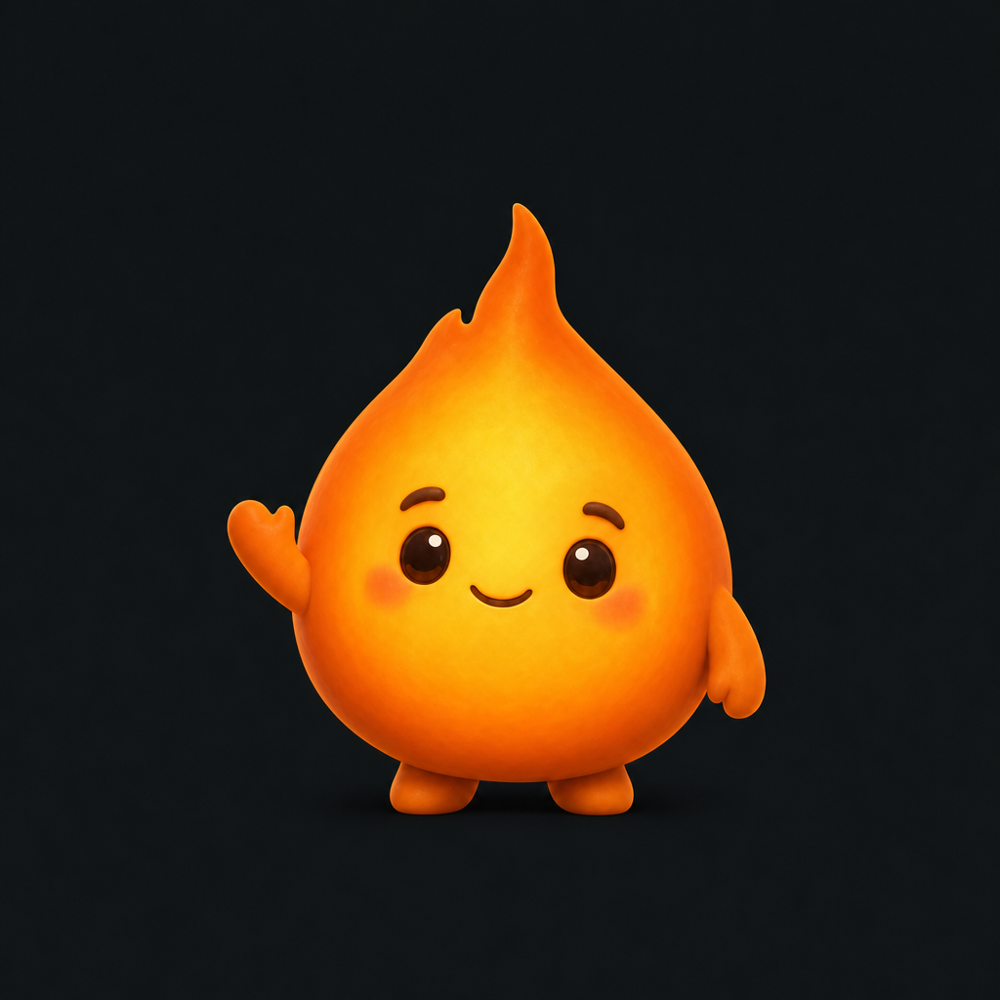

# myflames brand

<picture>
  <source media="(prefers-color-scheme: dark)" srcset="myflames-wordmark-on-dark.svg">
  
</picture>

**See what your database is doing.**

myflames is an open-source performance workspace for MySQL, MariaDB, and Percona Server for MySQL. Use this description and message across the repository, website, documentation, and project material.

## Logo and wordmark

The primary mark is a simple orange flame with a pale inner glow. Use the lowercase `myflames` wordmark alongside it when space allows. Keep the mascot as a companion illustration, rather than substituting it for the logo.

| Asset | Use |
| :--- | :--- |
| [myflames-logo.svg](myflames-logo.svg) | Primary flame mark, transparent background. |
| [myflames-wordmark-on-light.svg](myflames-wordmark-on-light.svg) | Flame and dark wordmark for light backgrounds. |
| [myflames-wordmark-on-dark.svg](myflames-wordmark-on-dark.svg) | Flame and warm white wordmark for dark backgrounds. |
| [myflames-mascot.png](myflames-mascot.png) | Friendly flame mascot for welcomes, learning, and community material. |
| [social-preview.png](social-preview.png) | Repository social preview, 1280 × 640 pixels. |
| [social-preview.svg](social-preview.svg) | Editable source for the social preview. |

Keep the mark's proportions and colors. Leave clear space of at least one quarter of its width on each side. Keep it separate from surrounding text and other logos. Use the appropriate wordmark for the background; the standalone flame works on light and dark surfaces.

The palette matches the separate website: flame `#FF873F`, inner glow `#FFE2A4`, charcoal `#141B1B`, and warm white `#F4F2E9`. Use a system sans-serif font for accompanying text.

## Mascot

The mascot brings warmth to learning and community material. Preserve its round body, upright flame crest, warm orange and gold colors, and kind expression. Its name is still undecided.

## Earlier app assets

The segmented marks `myflames-icon-v2.png` and `myflames-icon-v3.png`, the small `myflames-icon-v3-128.png`, and the original root `myflames.jpeg` remain for historical references and existing app builds. Use the new simple flame for new repository and website material. Existing released installers and the app's runtime icon are not changed by this repository branding update.

The workspace build currently emits its legacy icon at `/assets/myflames-logo.png`, shared by the sidebar, welcome image, and favicon. Keep that stable address and its compatibility behavior when the app adopts the new mark in a future change.

The SVG logo and wordmarks are original editable paths under the repository's Apache-2.0 license. The mascot was generated and refined with Krea GPT Image 2, with the original image preserved by the separate website project. Earlier segmented PNGs were generated from the original project artwork and remain unchanged.
