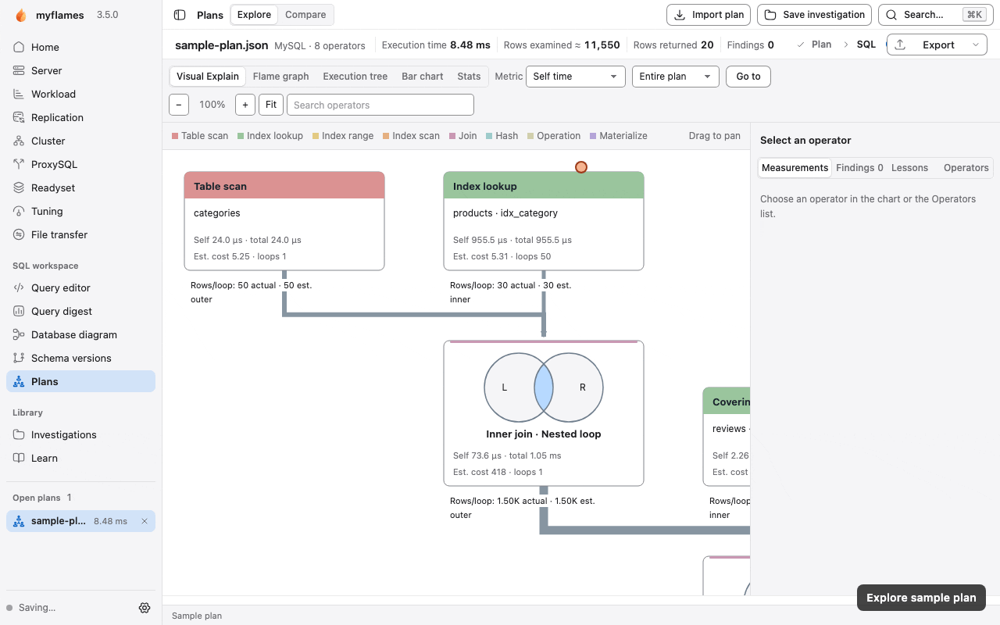
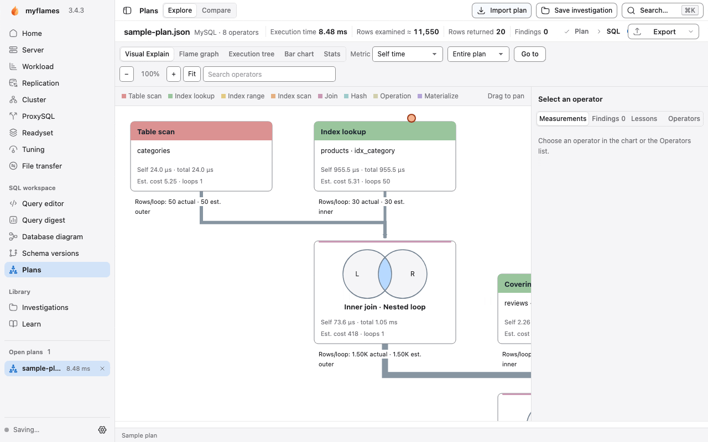
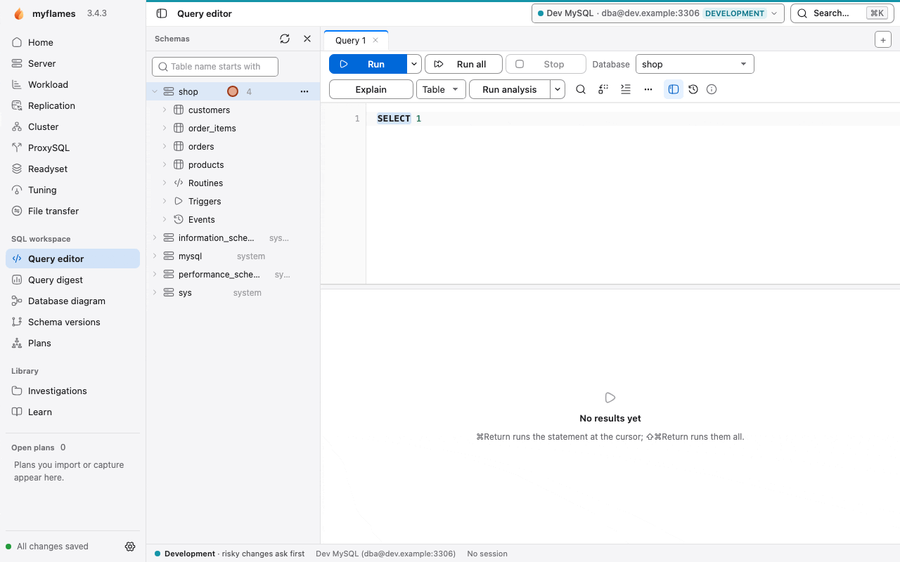
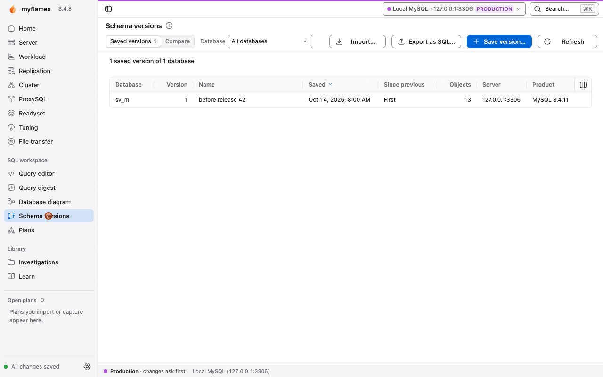

# Plans and schemas

Use these guides to compare execution plans, keep investigations and inspect or prepare schema changes in the desktop app.

- [Compare before and after execution plans](howto-plans.md#compare-before-and-after-execution-plans)
- [Find the slowest operator in a plan](howto-plans.md#find-the-slowest-operator-in-a-plan)
- [Save and reopen an investigation](howto-plans.md#save-and-reopen-an-investigation)
- [Export a plan report with literal values hidden](howto-plans.md#export-a-plan-report-with-literal-values-hidden)
- [Import a CSV file into a table](howto-plans.md#import-a-csv-file-into-a-table)
- [Inspect foreign keys and export a database diagram](howto-plans.md#inspect-foreign-keys-and-export-a-database-diagram)
- [Save a schema version](howto-plans.md#save-a-schema-version)
- [Compare a saved schema with the database now](howto-plans.md#compare-a-saved-schema-with-the-database-now)

## Compare before and after execution plans

Use this when you have two plans for the same query and want to assess a change.

1. Open **Plans** in the sidebar.
2. If a plan is missing, use **Import plan** to add its plan file.
3. Choose **Compare** in the top bar.
4. Choose the baseline plan in **Before**.
5. Choose the changed plan in **After**.
6. Select a row under **Operator changes** to highlight the matched operators.

What you see: the comparison shows both plans, their available measurements and the operators that were added, removed or changed.

Good to know:

- Estimated plans have no measured latency change. **Not executed** means a timing is unavailable, not zero.
- Each chart scales to its own plan's total time. Compare printed times across plans; uncertain operator matches are excluded from regression counts.

## Find the slowest operator in a plan

Use this when a measured plan has many operators and you need to locate where it spends its own execution time.

1. Open the measured plan in **Plans** > **Explore**.
2. Choose **Go to** > **Largest self time**.
3. Read **Self time** in the selected operator's **Measurements**.
4. Choose **Stats** in the chart view controls.
5. Compare the **Self time** columns in **Time per table** and **Time per operator type**.

What you see: the jump selects the operator with the largest self time; Stats groups self time across the plan by table and operator type.

Good to know:

- Self time excludes the time attributed to children. Stats adds self times across occurrences and loops, so it does not add inclusive parent and child times together.
- An estimated plan cannot identify the slowest measured operator. Its missing timings stay unavailable.
- Stats covers the whole original plan even when a chart branch is focused or collapsed.

## Save and reopen an investigation

Use this when you want to keep open plans, notes and a baseline together for later work.

1. With the plans open in **Plans**, choose **Save investigation** in the top bar.
2. Enter an **Investigation name**.
3. Choose the reference plan in **Baseline**.
4. Enter your findings in **Notes and conclusions**.
5. Choose **Save**.
6. Open **Investigations** in the sidebar.
7. Select the saved investigation.
8. Choose **Open all**.

What you see: the investigation's plans reopen together with its saved notes and baseline.

Good to know:

- Investigations stay on this computer. **Compare to baseline** needs a baseline and a second plan in the saved investigation.
- Saving an investigation excludes credentials, but plan contents and your notes can still contain sensitive values. Review an exported bundle before sharing it.

## Export a plan report with literal values hidden

Use this when you need to share a plan while hiding its SQL literal values.

1. Open the plan in **Plans** > **Explore**.
2. Open **Export** in the plan header.
3. Turn on **Hide literal values**.
4. Choose **HTML report** for a readable report, or **JSON** for a data file.

What you see: the app downloads a copy with literal values hidden while keeping the open plan unchanged.

Good to know:

- Hiding literals keeps identifiers and measurements. Table and column names can still reveal private information; inspect the exported file before sharing it.
- When the active view is **Stats**, the HTML report uses **Visual Explain**. Stats is an app view rather than an exported chart.

## Import a CSV file into a table

Use this when you need to load a delimited file into an existing table or create a table for it.

1. In **Query editor** > **Schemas**, right-click the target table, or a database for a new table.
2. Choose **Import CSV…** for an existing table, or **Import CSV into a new table…** for a database.
3. In **File and format**, choose **Choose file…** to select the file.
4. Check the preview against **Separator**, **Encoding**, **First row has column names** and **Empty fields are**.
5. Choose **Next** to open **Target and columns**.
6. Set the column mapping, or the new table's name and column types.
7. Choose **Next** to open **Check**, which validates the rows automatically.
8. Once the check allows it, choose **Review…**.
9. Inspect the target, session statements, row summary and data example; a new table also shows its CREATE TABLE.
10. Choose **Import**.

What you see: the import reports progress, then the committed and skipped row counts or the failure that stopped it.

Good to know:

- Checking explains missing privileges, refused mappings and row problems. Import asks first on **Development** connections too and records the attempt in **Audit log**; row values are excluded from that log.
- **Keep nothing** rolls back imported rows on a failure or Stop when the table is transactional. A newly created table remains. **Commit every N rows** keeps batches committed before a later failure or Stop.
- The review shows a shortened first data statement and a summary of the batches. Inspect the file and mapping as well as the SQL preview.

## Inspect foreign keys and export a database diagram

Use this when you want to inspect table relationships and save the diagram for later use.

1. Open **Database diagram** in the sidebar.
2. Choose the schema in **Database**.
3. Choose **Load** in the toolbar.
4. Search for a table or column in **Find a table or column**.
5. Click a table heading to read its **Relationships** in the inspector.
6. Open **Export**.
7. Choose **Editable JSON** to preserve metadata and positions, or **SVG image** for an image.

What you see: the inspector lists the supplied relationships and column mappings, and Export downloads a copy of the diagram.

Good to know:

- Choosing a database does not load it. Replacing an imported diagram or a different database's diagram asks first; export your layout if you want to keep it.
- **SQL schema** and **Mermaid** exports can omit details. If **Review export notes** opens, read the notes before choosing **Download file**.
- **Import** can build a diagram from SQL, Mermaid or diagram JSON without a server connection. Imported SQL is never executed.

## Save a schema version

Use this before a schema change when you want to keep the current definitions for comparison later.

1. Open **Schema versions** > **Saved versions**.
2. Choose **Save version…**; when the chosen database has no saved versions, the save button includes its name.
3. Select **Database** in **Save the schema of a database**.
4. Enter a useful **Name**, such as the release the schema belongs to.
5. Choose **Save version**.

What you see: a new version appears in **Saved versions**, with the database's definitions saved on this computer. Reading the definitions does not change the server or copy its table rows.

Good to know:

- If the version's inspector shows **May be incomplete**, read the coverage notes. Limited metadata privileges can leave objects or definitions unavailable for comparison.

## Compare a saved schema with the database now

Use this when you want to find differences from a saved schema and prepare SQL that would make the database match it.

1. Open **Schema versions** > **Saved versions**.
2. Select the version whose schema you want the database to match.
3. Choose **Compare with the database now**.
4. In **Differences**, select a changed object to inspect its definitions.
5. Choose **Sync script**.
6. If **Review before running** appears, read its warnings and items that were not generated.
7. Choose **Download .sql**, or **Open in Query editor** when it is available.

What you see: the comparison and script describe changes to **Target** that would make it match **Source**. Comparing and generating the script leave the server unchanged.

Good to know:

- **Compare with the database now** uses the saved version as Source and the current database as Target, so the script can undo later schema changes. For another direction, use **Compare** and choose the intended **Source** and **Target** explicitly.
- **Open in Query editor** needs a live target matching the connection in use. It opens the SQL without running it. Run DDL there one statement at a time and follow [Reviewed changes](safety.md#reviewed-changes).
- Unreadable or unsupported objects can leave gaps in the script. Review all warnings before deciding what to run.
