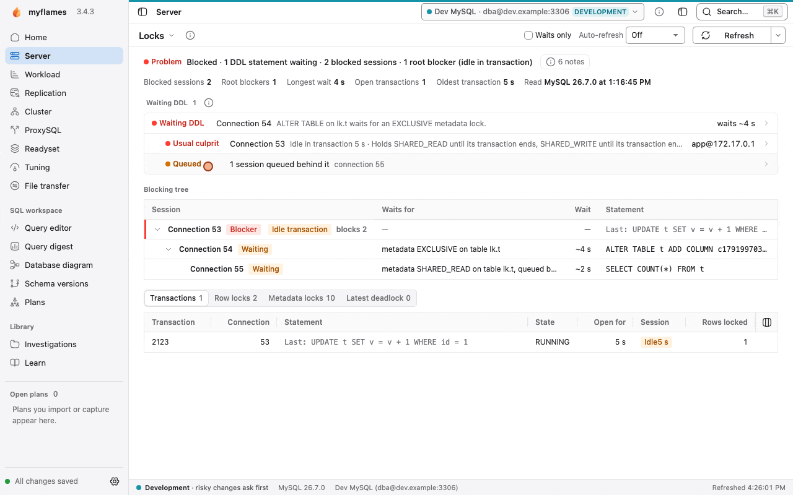
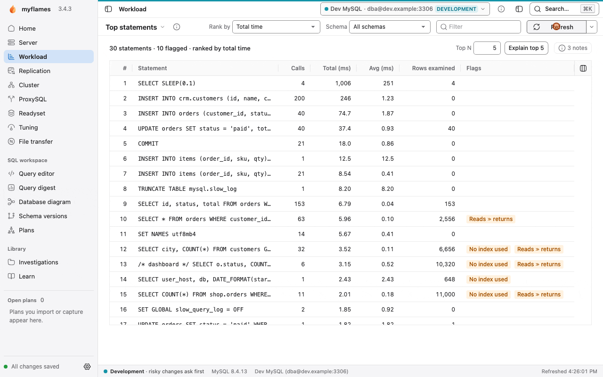
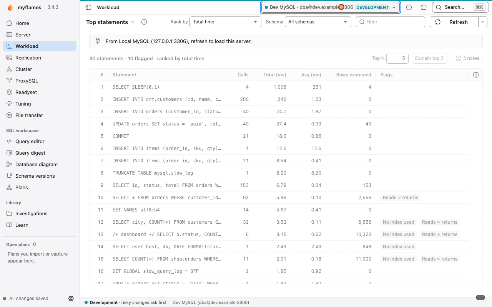
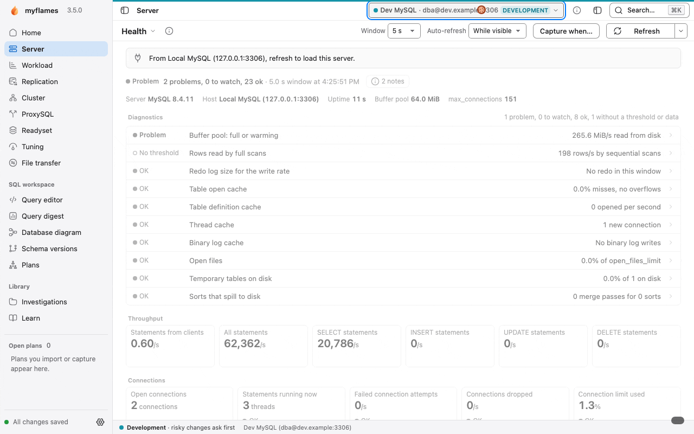
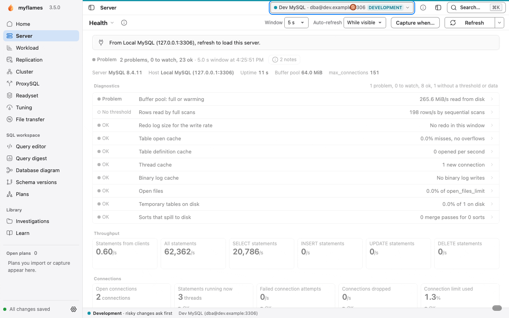
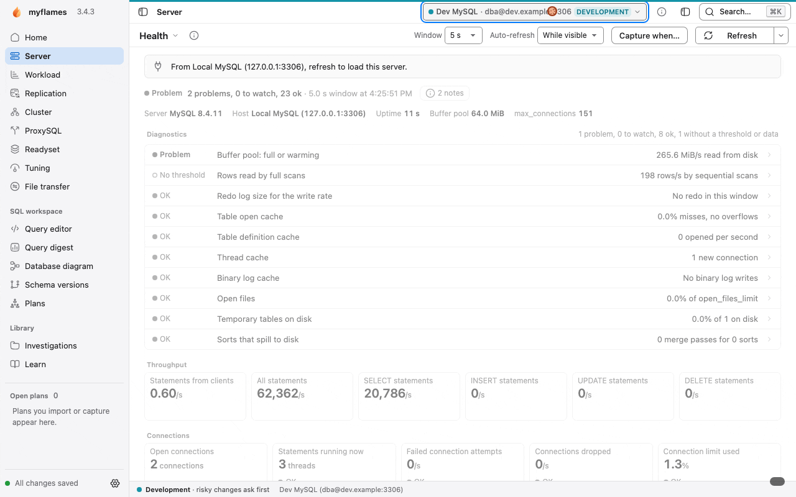

# Server and workload

Task guides for the Server and Workload places and the Tuning place. Reading a server never changes it; every change below shows the exact statements, asks first and is recorded in the Audit log.

- [Capture diagnostics automatically when load spikes](howto-server.md#capture-diagnostics-automatically-when-load-spikes)
- [Find and kill a blocking transaction](howto-server.md#find-and-kill-a-blocking-transaction)
- [Find the heaviest statements and explain their plans](howto-server.md#find-the-heaviest-statements-and-explain-their-plans)
- [Stop runaway sessions in batches](howto-server.md#stop-runaway-sessions-in-batches)
- [Test dropping an index by hiding it first](howto-server.md#test-dropping-an-index-by-hiding-it-first)
- [Add a column or rebuild a fragmented table](howto-server.md#add-a-column-or-rebuild-a-fragmented-table)
- [Change server parameters and compare two servers](howto-server.md#change-server-parameters-and-compare-two-servers)
- [Enable a Performance Schema preset](howto-server.md#enable-a-performance-schema-preset)
- [Check an upgrade and dump or restore a database](howto-server.md#check-an-upgrade-and-dump-or-restore-a-database)
- [Get MySQL Shell](howto-server.md#get-mysql-shell)
- [Create a database user and edit its grants](howto-server.md#create-a-database-user-and-edit-its-grants)
- [Grade a server and run a full analysis](howto-server.md#grade-a-server-and-run-a-full-analysis)

## Capture diagnostics automatically when load spikes

Use this when a problem comes and goes before you can look at it: a spike in running threads, a long row lock wait or a statement that runs too long.

1. Open **Server** > **Health**.
2. Click **Capture when…** in the toolbar.
3. Check one or more conditions and fill in their thresholds: **Threads running at or above**, **A row lock wait older than** or **A statement running longer than**, and choose how often to check.
4. Keep **Stop after the first capture** checked to capture once, or uncheck it to keep watching.
5. Click **Start**.

What you see: Health checks the server at the chosen interval while it stays on screen. When a condition is met, myflames reads the processlist, the InnoDB status and the locks, and saves them as a new investigation named after the condition that fired; open it from **Investigations**.

Good to know:

- The watch checks only while **Health** is on screen, and only the connection it started on. A capture already under way finishes even if you leave the view.
- Every read is a normal read of the server; nothing is changed, and nothing is sent anywhere else.

## Find and kill a blocking transaction

Use this when statements pile up behind one session: find the blocker in Locks and end its query or its connection.

1. Open **Server** > **Locks**. **Waiting DDL** names any blocked DDL, and **Blocking tree** shows who waits on whom; the **Transactions**, **Row locks**, **Metadata locks** and **Latest deadlock** tabs give the detail.
2. Select the session at the root of **Blocking tree** to see its statement, its open transaction and how long it has run.
3. Click **Kill…** in the inspector.
4. In the sheet, check **Statement to send**, then under **What to end** keep **Kill connection** or choose **Kill query only**.
5. Click **Kill connection <id>** to confirm.

What you see: before sending anything, myflames reads the session again and stops if it has changed or ended. Afterwards the view shows whether each blocked session still waits.

Good to know:

- **Kill query only** stops the running statement but leaves a longer transaction and its locks open, so blocked sessions can keep waiting; **Kill connection** rolls the transaction back, and the rollback itself can take a long time.
- Ending another user's session needs CONNECTION_ADMIN or SUPER on MySQL, CONNECTION ADMIN on MariaDB. The sheet greys the action with the reason when a privilege is missing.

## Find the heaviest statements and explain their plans

Use this when the server is slow and you do not know which statements to look at first.

1. Open **Workload** > **Top statements**.
2. Pick a **Schema** and choose the order in **Rank by**: **Total time**, **Average time**, **Rows examined** or **Full scans of the first table**.
3. Select a row to inspect its normalized SQL, example statement and metrics.
4. Click **Explain top 5** in the toolbar to capture estimated plans for the first five runnable SELECTs at once, or use a row's **Explain** for one statement.

What you see: each plan is added to the open plans with its plan-shape findings as badges, ready to inspect as a flame graph or tree. For a measured plan, use a row's **Run analysis** and confirm with **Execute and analyze**.

Good to know:

- The list comes from Performance Schema statement digests. When Performance Schema or its digest consumer is off, the view says so and points to the **Instruments** row that turns it on.
- **Run analysis** executes the statement inside a read-only transaction that is rolled back, with a time limit per run.

## Stop runaway sessions in batches

Use this when many sessions at once need to end, for example a pile of long-running queries after a deploy.

1. Open **Workload** > **Processlist**. To see candidates first, filter the list by **Active** or **Locked**.
2. Click **Kill sessions…** in the toolbar.
3. In the Kill sessions dialog, choose **Kill query** or **Kill connection**.
4. Under **Presets**, click **Runaway queries (> 30s)** or **Lock waiters** to select the matching sessions, or set your own filters.
5. Review every selected session and its SQL in the list, then click **Kill N queries** or **Kill N connections**.
6. Check the statements and click **Send N statements**.

What you see: before sending, myflames reads each session again and stops for any that changed or ended. The Processlist note then shows whether the killed sessions and their waiters are gone.

Good to know:

- System threads and your own connection are never listed as targets.
- Killing another user's session needs CONNECTION_ADMIN or SUPER on MySQL, CONNECTION ADMIN on MariaDB.

## Test dropping an index by hiding it first

Use this before removing an index that looks unused or redundant: hide it, watch the workload, then drop it or bring it back.

1. Open **Server** > **Indexes** and choose **Unused** or **Redundant** in the filter bar.
2. Select an index and check **Uptime** in the inspector: it says how long the server has been up, so how much workload the usage counts cover.
3. From the index's menu, choose **Set invisible…** on MySQL 8.0 or later, or **Set ignored…** on MariaDB 10.6 or later.
4. Review the ALTER TABLE statement and confirm.
5. After a few days of normal traffic, return to the same menu: choose **Set visible…** or **Set not ignored…** to restore the index, or **Drop index…** to remove it.

What you see: the optimizer stops considering the index in query plans while writes still maintain it, so plans change without losing the index.

Good to know:

- An unused or redundant finding is a candidate to investigate, not proof that dropping is safe: collection windows, restarts, instrumentation and rarer workloads all affect the evidence.
- MySQL 5.7 has no invisible indexes, so the hiding actions are not offered there.

## Add a column or rebuild a fragmented table

Use this when a table needs a schema change, or when deleted rows left space the server could return to disk.

1. Open **Server** > **Tables**. Choose **Missing primary keys** or **Fragmentation** in the filter bar to find candidates.
2. Click **Fresh numbers** first when the statistics may be cached, so sizes and fragmentation reflect the table now.
3. Select a table and click **Table structure** to see its columns, indexes, foreign keys and CREATE TABLE statement.
4. Click **Add column…**, **Remove column…** or **Optimize table…**.
5. Review the exact DDL and its algorithm in the sheet, then confirm.

What you see: the change runs as the reviewed statements, and the outcome is recorded in the Audit log.

Good to know:

- **Fresh numbers** sets information_schema_stats_expiry to 0 for myflames' own connection only; it changes nothing for other clients.
- A rebuild such as OPTIMIZE TABLE needs free disk of about the table's size, and on a replica the rebuild happens there too.

## Change server parameters and compare two servers

Use this to stage a tuning change with review, or to find configuration drift between a primary and a replica.

1. Open **Server** > **Parameters**.
2. Filter **Show** by **Recommendations** or **Dynamic** to find candidates; select a parameter to read its recommendation and a link to the official documentation.
3. Click **Edit** and enter the new values; each edit also asks whether the change applies **Now only** (SET GLOBAL) or is persisted (SET PERSIST, which also writes mysqld-auto.cnf).
4. Click **Review and apply**, check the exact statements and confirm.
5. To compare two servers, open the **Compare** tab, pick the second saved connection and click **Compare**. Differences are listed by default; check **Show identical** to see every parameter.

What you see: the apply runs the reviewed statements, and a parameter's inspector shows the change under **Changed through myflames**. The comparison lists each differing parameter with both values.

Good to know:

- Recommendations are rules of thumb; read a parameter's evidence before applying it.
- The **Versions** tab shows in which releases a parameter's default changed, which matters before an upgrade.

## Enable a Performance Schema preset

Use this when a view reports missing data because the matching instruments or consumers are off.

1. Open **Server** > **Instruments**.
2. Choose a bundle in **Preset** and read its summary and cost.
3. Click **Show statements** to preview the UPDATE statements on the performance_schema setup tables, then confirm to apply the preset.
4. For finer control, browse **Features**, **Instruments**, **Consumers** and **Actors and objects**, select rows and click **Enable**, **Enable without timing** or **Disable**.

What you see: the chosen rows change state, and views that needed them start reporting data on their next read.

Good to know:

- **Enable without timing** collects counts without durations; consumers have no timing option, so they offer **Enable** and **Disable** only.
- Instruments are a server change: the statements are reviewed before they run and recorded in the Audit log.

## Check an upgrade and dump or restore a database

Use this before a server upgrade, or when you need a logical backup or restore with the exact commands reviewed first.

1. Open **Server** > **Maintenance**. The **Tools** section lists the client tools found on this computer and which one is used for this server.
2. Switch to **Upgrade check**, pick a **Target version** and click **Check upgrade**.
3. Read the findings: incompatible objects and removed or changed parameters.
4. Switch to **Dump**, choose **Whole instance** or **Databases** in **Scope**, set an **Output folder** and click **Start dump…**. To load a dump later, use **Restore** and **Start restore…**.
5. After the preflight checks, review the exact commands and confirm.

What you see: the preflight runs reads only, then the review sheet shows the commands; a running job shows its progress, and a finished dump opens its folder.

Good to know:

- **Check upgrade** only reads; it reports findings, and never says an upgrade is safe. On MariaDB it lists the mariadb-upgrade steps to run on the server host.
- Dumps and restores need the matching client tools installed on this computer (for MySQL Shell, use **Get MySQL Shell** in **Settings** > **Client tools** > **Client tools…**; see [Get MySQL Shell](#get-mysql-shell)); when none can run, the tab names the missing program and offers **Choose client tools…** instead of starting.

## Get MySQL Shell

Use this when no usable MySQL Shell is on this computer and you want myflames to download Oracle's pinned MySQL Shell build for **Cluster** and **Maintenance**.

1. Click the gear at the bottom of the sidebar (**⌘,** / **Ctrl+,**) to open **Settings**, choose **Client tools**, and click **Client tools…** (or click **Change…** under **Used for this server** in **Server** > **Maintenance**).
2. In the **Client tools** dialog, scroll to **MySQL Shell**. When no usable copy is found, it offers **Get MySQL Shell** and notes that it downloads MySQL Shell 9.7.0 from Oracle into myflames's data folder (`tools/mysqlsh`), with **GPLv2 license (Oracle)** and **Oracle downloads** links (myflames does not redistribute MySQL Shell). If an installed copy is older than 9.7.0, it says `MySQL Shell <version> on this computer is older than 9.7.0, the version myflames works with.` and offers **Get MySQL Shell 9.7.0**; on an unsupported platform, it explains why and offers **Open Oracle downloads** instead.
3. Click **Get MySQL Shell** (or **Get MySQL Shell 9.7.0**). The progress bar shows `Downloading MySQL Shell 9.7.0 from Oracle` with the percentage and megabytes received (or `Still waiting for cdn.mysql.com.` after 10 seconds with no progress), then `Checking the SHA-256 checksum and archive files…` and `Checking MySQL Shell 9.7.0 and moving it into place…`; the SHA-256 checksum and archive files are verified before anything runs.
4. To cancel a running download, click **Stop** (`Download stopped; nothing was installed.`). If a download or check fails, the section reports `Could not install MySQL Shell:` with the error (`Nothing was installed.`) and offers **Try again** (and **Get MySQL Shell 9.7.0**).
5. When the install finishes, the status reads `MySQL Shell 9.7.0 is ready.` and the copy appears under **Found on this computer** as `Downloaded by myflames`, preferred over other MySQL Shell copies. Close the dialog with its **×** button; **Cluster** and **Server** > **Maintenance** use it afterwards where supported. VillageSQL dumps use mysqldump because MySQL Shell cannot dump VillageSQL custom types.

Related: [Maintenance](server.md#maintenance), [Cluster](server.md#cluster) and [Connect to a server](quickstart.md#connect-to-a-server).

## Create a database user and edit its grants

Use this to add an account or change what an account may do, with the GRANT and REVOKE statements reviewed first.

1. Open **Server** > **Users and roles** and click **New user** or **New role**, or select an existing account.
2. In the **Grants** tab of the inspector, pick a **Grant level**: **Global**, **Databases**, **Tables**, **Columns**, **Routines** or **Proxy**.
3. For a scoped level, click **Add scope** and name the database, table, column or routine.
4. Toggle the privileges in the matrix, then click **Review changes**.
5. Check the statements, type the account name to confirm and apply.

What you see: the account or its grants change as reviewed, and the change appears in the Audit log.

Good to know:

- The typed name binds the review to that account, so a mistake in the list cannot redirect the grants.
- To find privilege drift between two servers, open the **Compare** tab and pick another saved connection; accounts only on one side and differing grants are listed.

## Grade a server and run a full analysis

Use this for a periodic health check or a first look at an unfamiliar server.

1. Open **Tuning** in the sidebar; the **Scorecard** tab grades the checks it could measure.
2. Filter by **Needs attention**, **Not measured** or **All checks**.
3. Select a check to read its measured evidence, the workload context and the suggested parameter or SQL action.
4. Switch to **Full analysis** and click **Run full analysis** for the complete health, workload and schema report; start from its **Look at first** list.
5. Use **Export** to save the scorecard or the report as HTML, Markdown or JSON.

What you see: the scorecard groups checks by area with a verdict each; the full analysis ranks its findings so the most urgent come first.

Good to know:

- Verdicts and recommendations are rules of thumb built from measured evidence; read a check's evidence before acting on it.
- **Not measured** means the data was not available (for example instrumentation that is off), not that the check passed.

Related: [Server diagnostics & operations](server.md) describes each view in detail, and [write safety](safety.md#reviewed-changes) explains how reviewed changes work.
