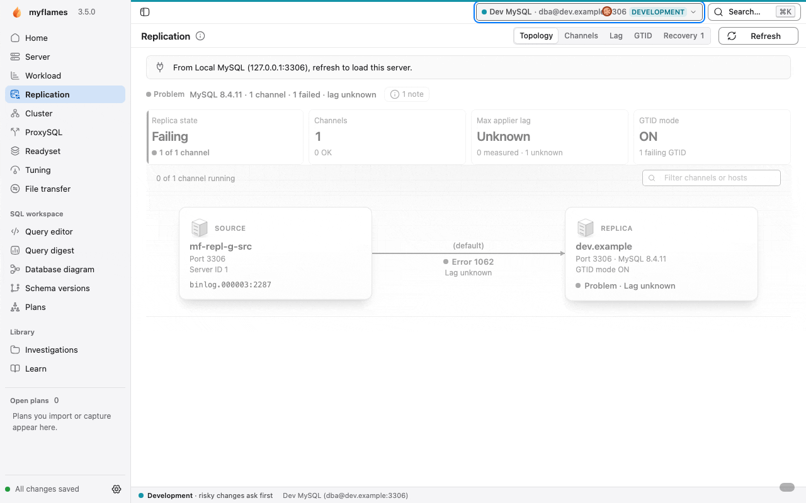
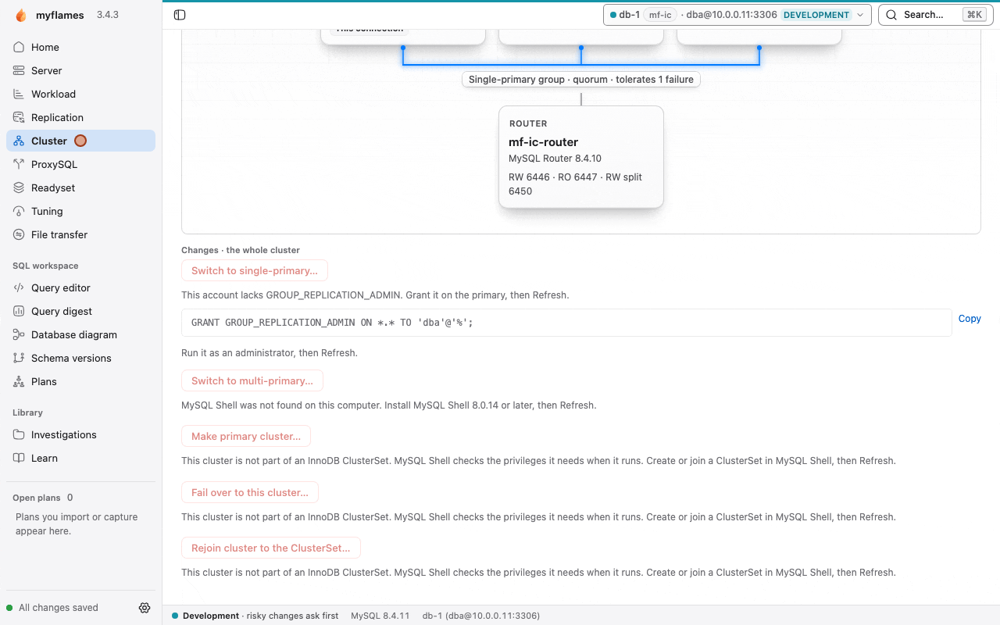
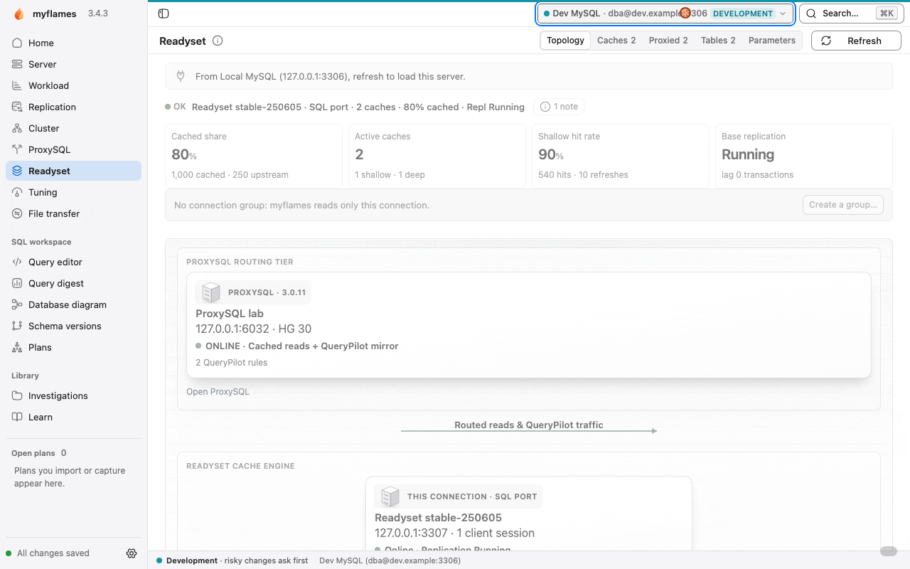

# Replication, clusters and proxies

Task guides for the Topology, Replication, Cluster, ProxySQL and Readyset places. Reads in these places never change a server; the changes below show the exact statements, ask first and are recorded in the Audit log.

- [Create a connection group from Home](howto-topology.md#create-a-connection-group-from-home)
- [Read a whole group in Topology](howto-topology.md#read-a-whole-group-in-topology)
- [Change a parameter on every server](howto-topology.md#change-a-parameter-on-every-server)
- [Skip a failing replication transaction](howto-topology.md#skip-a-failing-replication-transaction)
- [Switch the primary or mode of a cluster](howto-topology.md#switch-the-primary-or-mode-of-a-cluster)
- [Run a cluster action on another member](howto-topology.md#run-a-cluster-action-on-another-member)
- [Give an account a missing privilege for a cluster action](howto-topology.md#give-an-account-a-missing-privilege-for-a-cluster-action)
- [Take a ProxySQL backend out of traffic](howto-topology.md#take-a-proxysql-backend-out-of-traffic)
- [Create a Readyset cache for a query](howto-topology.md#create-a-readyset-cache-for-a-query)

## Create a connection group from Home

Use this when you already have saved connections for the servers in a cluster or replication topology and want to group them together on **Home**.

1. Open **Home** in the sidebar.
2. Click **New group…** in the **Connections** header (or in the **Group connections** empty state if no groups exist yet). Alternatively, tick the saved connections you want in the **Saved connections** table below and click **Group (N)…** in the table toolbar.
3. In **New group**, enter a **Group name** (up to 80 characters, distinct from any existing group).
4. Check or uncheck saved connections in the list (1 to 16 connections; a connection already in another group notes `Moves it from group <other>`).
5. Click **Create group**.

What you see: the new group appears under **Group connections** above **Saved connections** on **Home** (and under **Group connections** in the **Connection in use** picker), showing its server count, member names and strictest write-safety tags, along with **Open** (or **Refresh** and **In use** when active) and **Edit group…**.

Good to know:

- **New group…** pre-ticks the saved connection in use when there is one; **Group (N)…** pre-ticks the saved connections you selected in the table (unsaved connections cannot join a group).
- If creating or saving a group moves a member out of the **Group connection** currently in use, that active Group connection refreshes automatically when members remain; if every member moved out, its active server stays open as a plain connection and you can open the new Group connection explicitly.
- Click **Open** on the group card under **Group connections** to open it as a **Group connection** and go straight to the **Topology** place.

Related: [Open a Group connection and work on any server](howto-connections.md#open-a-group-connection-and-work-on-any-server), [Edit a connection group](howto-connections.md#edit-a-connection-group) and [Read a whole group in Topology](howto-topology.md#read-a-whole-group-in-topology).

## Read a whole group in Topology

Use this to inspect every member of a connection group together (map, member states, lag and configuration drift) without background polling.

1. Open a **Group connection**: click **Open** on a group card on **Home**, pick a group under **Group connections** in **Connection in use**, or switch to **Topology** while a grouped saved connection is in use and click **Open group connection `<group>`**.
2. On **Map** (the default tab), review the **Group topology diagram** (organized into **ProxySQL routing**, **Readyset caches**, **Database servers** and **Replicas · level N** tiers with cluster boxes and a legend for **Solid: verified**, **Dashed: not verified (address or server ID match)** and **Dotted: same server (alias)**; the diagram draws at most 600 links with any cap note sitting above it) and the text lists beneath it: **Servers** (saved members with address, role, state and read outcome, plus outside peers under **Not in this group** showing who reported them; lists stay complete up to 500 entries and page by 200 with **Show 200 more** above that), **Links** (`from → to`, kind, state, verification and any route reason; includes every link, paged by 200 with **Show 200 more**), **Clusters** and **Notes**. Select any server or peer card to inspect its **Member**, **Channels**, **Links** (**State and verification** and **Evidence**) or **Reported peer** details.
3. Switch to **Members** for the summary line (which highlights version drift when members run different versions and counts read, failed and not-reached servers) and the table showing **Server**, **Role**, **State**, **Engine and version**, **Read only**, **Lag**, **Behind** and **Read**. Select any row to inspect channels, choose that member for your next visit to **Server** with **Use in Server views** (which keeps you on **Topology**), or jump with **Open in Cluster** or **Open in Replication**.
4. Switch to **Parameters**, **Accounts** or **Plugins** to compare global settings, user accounts and roles, or plugins and MySQL components across the read members. Use **Show** (**Differences** or **All**) and the search box (`Search parameters…`, `Search accounts…` or `Search plugins…`) to filter rows. Select a row in **Parameters** to inspect values per member and start **Change on every member…**, or select a row in **Accounts** to inspect **Differences** and jump with **Open in Users and roles on `<member>`**.
5. Click **Refresh** in the toolbar whenever you want a fresh read of the tab on screen (or **Load** / **Retry** if a tab has not loaded yet).

What you see: each tab sends one bounded read across the saved members only when it first comes on screen for that **Group connection** and when you click **Refresh** (at most 4 logins at once, 30 s per query (2 s for the replication, cluster, ProxySQL and Readyset queries that **Map** shares with those places' topology bars), 120 s per tab request on **Map**, **Members**, **Parameters** and **Plugins**, and 300 s on **Accounts**, where accounts are read one at a time). Returning to a tab that already read keeps its report without logging in again.

Good to know:

- **`Alias of <member>`**: when several saved MySQL connections in the group reach the same `server_uuid` (for example a direct connection and a router or proxy port), myflames keeps all of them in **Servers** and **Members** and chooses one canonical connection (preferring a saved connection matching the server's reported port and host, or its reported port, or falling back across all aliases with a port-forwarding note when none uses the reported port; within each step preferring direct connections over MySQL Router sessions, then oldest saved connection). Every other alias gets **`Alias of <member>`** and a dotted **`Same server (alias)`** link to the canonical connection. Drift tables (**Parameters**, **Accounts** and **Plugins**) list all of them; a rolling parameter change refuses an alias when `<member>` is also selected.
- **`server ID match, not verified`**: on MariaDB replication channels without a source UUID, if `source_server_id` matches a single read MariaDB member in the group without matching its saved endpoint address, myflames labels the link **`server ID match, not verified`** (and draws it dashed) because server IDs can collide (for example the default `1`). A link matched by `server_uuid`, or by `server_id` confirmed with a matching address, is labeled **`verified`** (solid); an address-only match is **`address match, not verified`** (dashed).
- **Per server** settings: on **Parameters**, **Differences** hides settings that match across members and hides expected per-node settings (`server_id`, `server_uuid`, `server_uid`, addresses, paths, `wsrep_provider_pc_weight`, `wsrep_provider_gmcast_segment`, role-driven `read_only` / `super_read_only` only when both source and replica roles are present, sources are writable, replicas are read-only and values agree within each role, so Galera nodes are not folded, and `auto_increment_offset` when every compared member is observed in an active multi-primary Group Replication or Galera cluster with `wsrep_auto_increment_control` ON). Choose **All** to show every row, with **Per server** pills marking those per-node settings.
- **Not compared**: beneath **Parameters**, **Accounts** and **Plugins**, **Not compared** lists saved members omitted from that comparison along with the reason: for example ProxySQL Admin or Readyset members (read for identity only), failed logins or unreachable members, members not started before the request budget closed (120 s, or 300 s on **Accounts**), or incomplete inventories (such as more than 1,000 accounts or denied system tables). On **Accounts**, individual unreadable accounts (including accounts with a grant line over 1,048,576 characters, which cannot be compared, exported or changed) are named in the affected member's **Not compared** entry and dropped from every member's rows so they cannot appear as absent drift while readable accounts still compare. Truncated values (including values at source length limits in characters or UTF-8 bytes, or over 65,536 characters) and secret or credential-bearing parameter values (`wsrep_sst_auth`, `file_key_management_filekey`, telemetry headers or credential URLs) show as **Missing** with a reason rather than comparing as equal.
- Saving group membership changes or reopening the **Group connection** updates its snapshot and clears stale topology reports for the previous membership without starting a read on its own. After editing a non-active saved member's host or port on **Home**, click **Refresh** on the **Topology** tab or reopen the **Group connection**.
- **ProxySQL backend routes on Map**: a ProxySQL backend in a monitor's offline hostgroup, `OFFLINE_SOFT`, or `OFFLINE_HARD` is drawn as offline with its short `hostgroup N` label on the diagram; the reason (offline hostgroup, `OFFLINE_SOFT`, `OFFLINE_HARD`, shunned for replication lag, or no `ONLINE` member in the hostgroup) appears in the **Links** list, the link tooltip, and the card inspector.

Related: [Create a connection group from Home](howto-topology.md#create-a-connection-group-from-home), [Open a Group connection and work on any server](howto-connections.md#open-a-group-connection-and-work-on-any-server) and [Connection groups and topology consent](safety.md#connection-groups-and-topology-consent).

## Change a parameter on every server

Use this from **Topology** > **Parameters** when you want to roll one global server variable value across 1 to 16 members of a connection group in a safe order under one review.

1. Open **Topology** > **Parameters** on a **Group connection** and select the parameter row you want to change.
2. In the inspector, click **Change on every member…** (disabled with the reason beneath it if the Group connection is **Read-only**, the setting is **Per server**, or any compared member's value is redacted, truncated or unavailable).
3. In **Change `<parameter>` on every member?**, enter **New value** (prefilled with the most common current value), choose **When it applies** (**This server now (SET GLOBAL)**, **Now and after restart (SET PERSIST)** or **After restart only (SET PERSIST_ONLY)**), tick or untick **Members** (ProxySQL Admin, Readyset and **Not compared** members stay unticked and disabled with their reason) and click **Review**. When every changeable member is MariaDB, only **This server now (SET GLOBAL)** is shown; in mixed MySQL and MariaDB groups, MariaDB members plan `SET GLOBAL` plus the `[mysqld]` option-file line to copy.
4. Check the reviewed order and each member's pill (**Planned**, **Unchanged** or **Refused**), exact SQL statement, statement kind badge, scope changes (**Global**, **Persisted**), effect and caveats. If any selected member is **Refused**, **Apply** stays disabled (`Untick the refused servers and review again.`): click **Back** to adjust your selection.
5. On a **Production** group, type the exact group name under **Type `<group>` to confirm**. If any group member is excluded (not changeable or unticked), tick **I understand `<names>` will not be changed.**. Click **Apply** to start (or **Cancel**; cancelling a reviewed plan records a declined attempt in the **Audit log** when at least one member has a planned SQL statement, while cancelling an all-**Unchanged** or all-**Refused** plan records no attempt).

What you see: myflames runs the reviewed statements sequentially, one server at a time, re-checking each server before sending and stopping on the first failure, mismatch, refusal, warning-only no-op or adjusted value.

Good to know:

- **Plan refusals**: myflames refuses before any login if the variable is a secret variable (such as `wsrep_sst_auth` or `file_key_management_filekey`), if **New value** is bare `DEFAULT`, or if any member in the group is **Read-only** (even an unselected one). During **Review** (member planning, after server reads start), myflames also refuses `DEFAULT` tokens inside `SET` or `FLAGSET` running-value assignments (including MariaDB `SET GLOBAL` fallbacks), requested values over 4,096 characters, current values at a server source length cap (characters or UTF-8 bytes), proxies or caches, a duplicate server selected beside its canonical connection (for example a router alias), MariaDB servers without `server_uid` (requires MariaDB 10.11.9 or 11.4.3 or later), or a changed group or active endpoint.
- **Rolling order**: the review explains the order it builds from live topology facts: asynchronous replication runs deepest replicas first and the root source last (and names `MariaDB sources matched by server ID` when matched by server ID; confirmed ProxySQL Admin and Readyset members are excluded from topology ordering dependencies, while an unreadable database member still refuses all selected members whenever cluster or replication ordering applies), Group Replication and InnoDB Cluster secondaries run before their primary, Galera and PXC ties use `wsrep_node_name` order, and remaining ties use saved connection name order.
- **Pre-write checks and unchanged members**: before each member (including **Unchanged** members, which receive no statement), myflames re-checks group membership and generation, write policy, replication or cluster dependencies, live role, server identity in the same packet as the write (`server_uid` and version on MariaDB), and the current variable value. The single-use review expires once a run starts, so replaying it returns **Stale review** (**Review again**) with no per-member results.
- **The run banner**: a running change belongs to the workspace rather than the dialog. Closing the sheet (with **Close** or `Escape` once available) or switching connections keeps it going under a banner at the top of **Topology**: **`Rolling change running: <parameter>, server <k> of <n>.`** (or **`Rolling change finished: <parameter>.`**) with **Show** to reopen the sheet on that run, or **`Rolling change running in group <other>.`** (without **Show**) when viewing another group or an edited membership. If the reply to **Apply** is lost over the network, the sheet keeps polling progress (from 1 s up to 10 s), keeps **Stop** available and notes when progress stops answering without ending the run; if progress reports unknown, polling and **Stop** stay active for up to 30 s before reporting that the server no longer reports the change and linking to the **Audit log**.
- **Stop**: **Stop** prevents the next member from starting without interrupting a statement already sent (`Stop requested. No later server will start; a statement already sent is not interrupted.`); if the stop request fails to reach the server, it shows the error and stays enabled so you can retry.
- **Outcomes and the Audit log**: the final summary shows overall **Applied**, **Partially applied**, **Refused**, **Stopped** or **Stale review** and per-member **Applied**, **Unchanged**, **Refused** (including login failures such as MariaDB error 1698, where nothing was sent), **Not sent** or **Outcome unknown** (an interrupted or timed-out sent statement that may have run; check that server before reviewing another change). Every member writes one `Rolling parameter change` record under the shared change set ID in **Settings** > **Audit log** (and in that parameter's audit history in **Server** > **Parameters**), via **Open the Audit log**. Afterwards, **Parameters** prompts you to **Refresh** rather than re-reading automatically.

Related: [Read a whole group in Topology](howto-topology.md#read-a-whole-group-in-topology), [Change server parameters and compare two servers](howto-server.md#change-server-parameters-and-compare-two-servers) and [Reviewed changes](safety.md#reviewed-changes).

## Skip a failing replication transaction

Use this when a replica's applier stopped on one transaction you can safely skip, for example a row that already exists.

1. Open **Replication** in the sidebar. **Topology** shows the sources and this replica; **Channels** (**Connections** on MariaDB) lists the thread states and the last error; **Lag** and **GTID** give the positions.
2. Switch to **Recovery** and select the stopped channel to inspect the failing GTID or event and its error message.
3. Click **Skip this transaction…** to skip the one failing transaction, or **Skip until stopped…** to keep skipping each failure until you stop the loop.
4. Check the exact statements in the sheet, then click **Skip transaction** (or **Start skipping**).

What you see: the sheet re-reads the failure before it opens and is planned again when the server or the statements changed, so what you confirm is what runs. Afterwards the channel's applier starts again and the view shows it catching up.

Good to know:

- A skipped transaction is missing on the replica: skip only when the data is already there or no longer wanted.
- On MySQL 8.0 the skip uses SET GTID_NEXT and needs SUPER, SYSTEM_VARIABLES_ADMIN, SESSION_VARIABLES_ADMIN or REPLICATION_APPLIER; on MySQL 5.7 and on the counter method, SET GLOBAL sql_slave_skip_counter needs SUPER; on MariaDB, START SLAVE needs REPLICATION SLAVE ADMIN.

## Switch the primary or mode of a cluster

Use this for a planned switchover before maintenance, or to change between single-primary and multi-primary.

1. Open **Cluster** in the sidebar. **Topology** shows the members and their states; **Members** (**Nodes** on Galera and Percona XtraDB Cluster) lists each one; **Routers** appears for InnoDB Cluster. Below the summary line, a sentence says which server this connection reaches (`You are connected to <member>…`), and that server is marked **This connection** on its card, in the table and in its inspector.
2. To move the primary to another server, select an `ONLINE` secondary member on **Topology** or in **Members** to open its inspector, click **Make primary…**, check the statement or MySQL Shell call in the sheet, and click **Make `<member>` primary**. The current primary becomes a read-only secondary once its running transactions finish.
3. To change the mode of the cluster or run an InnoDB ClusterSet change, scroll to **Changes · the whole cluster** on the **Cluster** overview below the tab content, click **Switch to multi-primary…** or **Switch to single-primary…** (or in a ClusterSet, **Make `<cluster>` the primary cluster…**, **Fail over to this cluster…** or **Rejoin `<cluster>` to the ClusterSet…**), type the cluster or member name to confirm, and click **Switch to multi-primary** or **Switch to single-primary**.

What you see: every action for the cluster kind stays visible on the overview under **Changes · the whole cluster** or in each member's or node's inspector (**Make primary…**, **Stop Group Replication…**, **Start Group Replication…** and **Rejoin to the cluster…**, or on MariaDB Galera **Desync this node…**, **Resync this node…** and **Bootstrap a Primary component…**). Any action that cannot run now stays visible and disabled with the reason and the fix in plain words under it. After a confirmed change runs, the **What changed** table shows the state before and after, explaining in plain words why any value was not reported instead of saying "Not readable".

Good to know:

- InnoDB Cluster mode switches, member rejoin (**Rejoin to the cluster…**) and ClusterSet changes (**Make primary cluster…**, **Fail over to this cluster…** and **Rejoin cluster to the ClusterSet…**) run through MySQL Shell installed on this computer (use **Get MySQL Shell** in **Settings** > **Client tools** > **Client tools…** if needed; see [Get MySQL Shell](howto-server.md#get-mysql-shell)) and stay disabled over an SSH connection, because MySQL Shell connects to the other members directly outside the tunnel.
- Mode switches are refused inside an InnoDB ClusterSet, on an InnoDB Cluster unless every member is `ONLINE`, on a read replica, or for **Switch to multi-primary…** while `group_replication_preemptive_garbage_collection` is `ON`. On MariaDB Galera there is no primary to switch; a node's inspector offers **Desync this node…**, **Resync this node…** and **Bootstrap a Primary component…**.

Related: [Run a cluster action on another member](howto-topology.md#run-a-cluster-action-on-another-member), [Cluster](server.md#cluster) and [Reviewed changes](safety.md#reviewed-changes).

## Run a cluster action on another member

Use this when you want to stop or start Group Replication, desync or resync a Galera node, or run another member action on a server other than the one you first connected to.

1. Open **Cluster** in the sidebar and select the other member or node on **Topology** or in **Members** (**Nodes** on Galera) to open its inspector.
2. When a **Group connection** is open (see [Open a Group connection and work on any server](howto-connections.md#open-a-group-connection-and-work-on-any-server)), the line under the summary says `Each member's actions run through its own saved connection in <group>.`. Click the action in the member's inspector (such as **Stop Group Replication…**, **Start Group Replication…**, **Desync this node…** or **Resync this node…**). If the member was matched only by its `host:port` address, a note under the button says `Review checks that <connection> (<host:port>) is this member.`; on a remote MariaDB Galera node, **Desync this node…** and **Resync this node…** note `Review checks wsrep_desync and the state on this node's own connection.`.
3. In the review sheet, verify **Target** and **Runs on** (which name the member's saved connection `<connection> (<host:port>)`), **Server UUID** or **Galera node UUID**, and **Listed in the cluster as**. Type the saved connection's name if the action asks for confirmation, then confirm.
4. When you are using a single connection instead of a **Group connection**, local member actions on other servers stay disabled because they run on the server they change (`<Action> runs on the server/node it changes, <member>; this connection is to <current>.`). When a saved connection on this computer matches that member's address, click **Use `<connection>`** under the disabled action in the inspector (or on the member's card in **Topology**) to switch to that server and run the action there.

What you see: in a **Group connection**, clicking the action logs in to that member's saved connection in the group, verifies that its live `server_uuid` (or `wsrep_gcomm_uuid` on Galera) matches the selected member and that the member is local to that session, and opens the review sheet bound to that saved connection. Without a **Group connection**, **Use `<connection>`** switches the active connection to that server and reloads **Cluster** from it.

Good to know:

- In a **Group connection**, **Rejoin to the cluster…** on a `MISSING`, `OFFLINE` or `ERROR` InnoDB Cluster member is the exception: it runs through the active `ONLINE` member with quorum (using MySQL Shell) and names the missing member in **Instance**, so it does not need a saved connection for the missing server.
- A member action in a **Group connection** stays disabled when no saved connection in the group can run it safely: if no saved connection in the group matches the member, it says `Add a saved connection for <member> to this group.` and offers **Edit group…**; if unconfirmed connections exist in the group, it asks you to open the one that reaches that member on its own and view **Cluster** once to confirm it; if the matching connection has no saved password, it asks you to save its password first; and if two saved connections in the group reach the same member (for example a direct connection and a MySQL Router or ProxySQL connection), it names both and offers **Use `<connection>`**.
- If the member's saved connection reaches a different server when planning starts, or if the connection leaves the group before you confirm, myflames refuses the action with nothing sent.

Related: [Open a Group connection and work on any server](howto-connections.md#open-a-group-connection-and-work-on-any-server), [Edit a connection group](howto-connections.md#edit-a-connection-group) and [Cluster](server.md#cluster).

## Give an account a missing privilege for a cluster action

Use this when a cluster action is disabled because the connected account (or the target member's saved connection in a group) lacks a required MySQL or MariaDB privilege.

1. Open **Cluster** in the sidebar and find the disabled action under **Changes · the whole cluster** on the overview or in the selected member's inspector.
2. Read the reason under the disabled button: it names the missing privilege (for example `Needs GROUP_REPLICATION_ADMIN or SUPER.` on MySQL or `Needs SUPER.` on MariaDB Galera) and says `Run the statement below as an administrator, then Refresh.`.
3. Click **Copy** beside the `GRANT` statement box under the reason to copy the exact `GRANT` built for that session's `CURRENT_USER()` account.
4. Grant the privilege as an administrator on that server: either switch to an administrator connection and run the copied `GRANT` in **Query editor** (or grant the privilege in **Server** > **Users and roles** under **Grants** and click **Review changes**), or run it in another SQL client.
5. Return to **Cluster** on the original connection and click **Refresh** in the toolbar.

What you see: after **Refresh**, myflames re-reads `SHOW GRANTS` for the account that runs the action; once the required privileges are present, the action button becomes enabled so you can click it to review and confirm the change.

Good to know:

- myflames never runs the suggested `GRANT` statement as part of a cluster action. For InnoDB Cluster mode switches and replica-cluster switchover through MySQL Shell, the suggestion includes both the global privileges and the `mysql` and `mysql_innodb_cluster_metadata*` schema privileges with `WITH GRANT OPTION`, escaping `_` and `%` in schema names when `partial_revokes` is `OFF`.
- When `SHOW GRANTS` or `CURRENT_USER()` could not be read or verified, myflames does not disable an otherwise eligible action. Instead, it shows `Privileges could not be read; the server refuses the change if one is missing.` under the action (and in the review sheet's warnings), and the server itself enforces the privilege check when the statement runs.
- For MySQL Shell actions whose privileges MySQL Shell checks only at runtime (**Rejoin to the cluster…**, **Make `<cluster>` the primary cluster…**, **Fail over to this cluster…** and **Rejoin `<cluster>` to the ClusterSet…**), the action notes `MySQL Shell checks the privileges it needs when it runs.`. If a schema-scoped `GRANT` needs wildcard escaping and `partial_revokes` could not be read in the session, myflames omits the `GRANT` box and asks you to **Refresh** and try again.

Related: [Create a database user and edit its grants](howto-server.md#create-a-database-user-and-edit-its-grants), [Users and roles](server.md#users-and-roles) and [Cluster](server.md#cluster).

## Take a ProxySQL backend out of traffic

Use this to drain a backend before restarting it, or to check where the query rules send each statement.

1. Open **ProxySQL** in the sidebar, connected to the ProxySQL Admin interface (port 6032 by default).
2. Check **Topology**, **Servers**, **Hostgroups**, **Query rules** and **Query digests**.
3. In **Servers**, select the backend and click **Set OFFLINE_SOFT…** in the inspector; **Change weight…** shifts traffic gradually instead.
4. Review the statements and confirm: the change edits the memory copy and loads it to runtime in one reviewed step.
5. On the **Configuration of servers** line, click **Save servers to disk…** so the change survives a ProxySQL restart.
6. Open **Query digests** to see which rule evaluated each statement and where it was routed.

What you see: an OFFLINE_SOFT backend gets no new traffic while queries and transactions already on it finish; the Servers list shows it out of the runtime pool.

Good to know:

- ProxySQL keeps three copies of its configuration (memory, runtime and disk). Save to disk is a separate, separately reviewed change; the result of a change offers it as the next step.
- **Set OFFLINE_SOFT…** is not offered for a server a monitor manages (for example the Galera monitor), because the monitor would put it back in traffic within seconds.

## Create a Readyset cache for a query

Use this when a frequent proxied query should be served from Readyset instead of the upstream database.

1. Open **Readyset** in the sidebar and select **Proxied** to see the uncached queries observed passing through Readyset.
2. Select a query and click **Create cache…** in the inspector.
3. In the **Configure Readyset cache** sheet the support check runs as soon as the sheet opens with the query pre-filled; the **Check support (EXPLAIN)** button re-runs it after you edit the query. Read the **Shallow** and **Deep** verdicts with their reasons.
4. Choose the **Cache type**: **Shallow cache (TTL & refresh)** or **Deep cache (streaming dataflow)**. For a shallow cache, set **TTL (seconds)** and optional refresh and coalesce values.
5. Click **Review CREATE CACHE…**, check the exact statement and confirm.

What you see: the cache is created and appears on the **Caches** tab with its type and status; matching queries stop being proxied to the upstream for reads the cache serves.

Good to know:

- The support check runs EXPLAIN CREATE CACHE as a dry run; when one cache type is unsupported the sheet says why and pre-selects the other.
- A new cache whose query collides with an existing cache replaces it; the sheet names the collision before you confirm. The **Caches** tab's **Export SQL** exports the cache definitions as DDL; exports start with a `charset utf8mb4` line when runnable SQL or an emitted `USE` statement contains a non-ASCII character immediately before a backtick or backslash, so import them with the `mysql` or `mariadb` client.
